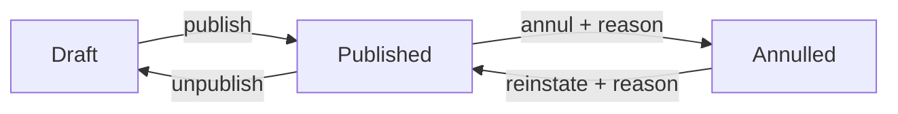

# Annul and reinstate a question

Technical terms: [glossary](../glossary.md)

Manual page for the user: [Questions](../manual/en/questions.md)

## Trigger
A curator with `questions.manage` opens a saved question at `/admin/questions/{id}` and presses **Annul question** (the question is `Published`) or **Reinstate question** (it is `Annulled`). Annulling is only in the Publication card; the list shows the chip and the filter.

## Steps
1. The curator presses the button; it is disabled while the form has unsaved changes (the action acts on what is stored).
2. A dialog asks for the reason (1 to 500 characters after trimming) and sends it to `POST /api/v1/question-bank/questions/{id}/annul` or `.../reinstate`.
3. The handler reads the question and its latest version, calls `Question.Annul(latest, reason)` or `Question.Reinstate(latest, reason)`, adds the version it returns and saves once: the status and the version are one write.
4. The response is the question with `Status` and `Annulment`; the form replaces its saved copy, reloads the History card and freezes or unfreezes its fields.



## Rules
- Only a `Published` question is annulled; a draft answers `question.not_published`, an annulled one `question.already_annulled`.
- An annulment is a new version: a copy of the latest, `Annulled` true, never an answer key change. A reinstatement is a new version with `Annulled` false and the reason as its note. Earlier versions are never touched.
- An annulled question is frozen: save, publish, unpublish and delete answer `question.annulled` (409); reads, the history and the preview still work. It keeps its topic, edition, paper number and notice subject, so it still blocks their delete and its paper number.
- `Status` is a concurrency token of the question: a write that read another status than the stored one (an annulment racing an unpublish, a save racing an annulment) answers `question.version_conflict` (409) and writes nothing.
- Practice reads `Published` only, so an annulled question leaves it by its status; how an edition simulation scores it is the edition's rule (epic E-6).

## Wireframe
The Publication card, for a published question and for an annulled one:
```text
+--------------------------------------------------------+
| Publication                                            |
| [Published]  This question is published.               |
| [ Unpublish ]  [ Annul question ] [new]                |
+--------------------------------------------------------+

+--------------------------------------------------------+
| (!) This question is annulled and cannot be edited.    |
|     Reinstate it to change it.                  [new]  |
+--------------------------------------------------------+
| Publication                                            |
| [Annulled] [new]   Annulled on 13 Oct 2026             |
| Reason: The organizer annulled item 12 in the          |
| final answer key.                               [new]  |
| [ Reinstate question ] [new]                           |
+--------------------------------------------------------+
```
The dialog:
```text
+--------------------------------------------+
| Annul this question?                [new]  |
|                                            |
| Practice will stop using it. You can       |
| reinstate it later; the history is kept.   |
|                                            |
| Reason *                                   |
| [______________________________]   0/500   |
|                                            |
|                  [ Cancel ]  [ Annul ]     |
+--------------------------------------------+
```
One annulled row of the list:
```text
+--------------------------------------------------------+
| Status: [x Annulled] [changed]                         |
+--------------------------------------------------------+
| Statement        | Source      | Status      | Type    |
| Which article... | CEBRASPE 24 | [Annulled]  | T/F     |
|                  | #12         | [changed]   |         |
| row menu: no Publish/Unpublish, Delete disabled [changed]|
+--------------------------------------------------------+
```

## Errors
- `question.not_published` — annul of a draft (409).
- `question.already_annulled` — annul of an annulled question (409).
- `question.not_annulled` — reinstate of a question that is not annulled (409).
- `question.annulled` — save, publish, unpublish or delete of an annulled question (409).
- `question.status_reason_required` — no body, or a blank reason (400).
- `question.status_reason_too_long` — more than 500 characters (400).
- `question.version_conflict` — another write took the next version number or changed the status first (409).
