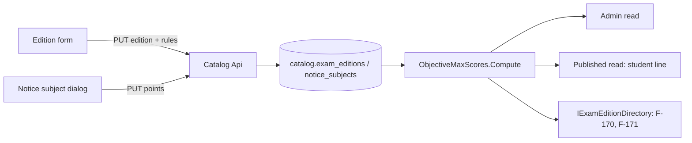

# Exam rules of an edition

Technical terms: [glossary](../glossary.md)

## Trigger
An admin (`catalog.manage`) saves the edition form at `/admin/exams/{examId}/editions/{id}`, or saves a notice subject in its dialog on the same page.

## Steps
1. The edition form sends `DurationMinutes`, `ObjectiveCutOffScore`, `EssayMaxScore` and `EssayCutOffScore` with the rest of the edition (`POST/PUT /api/v1/catalog/exams/{examId}/editions[/{id}]`). The duration is typed as hours and minutes and sent as whole minutes; the scores are typed in `AppScoreField` in the reader's culture (F-181, [number controls](number-controls.md)): only the culture's decimal separator is accepted, the value is rounded to two places when the field is left, and a text that is not a number blocks the save.
2. `SaveExamEditionHandler` calls `ExamEdition.SetRules` after the shape of the edition is valid; a PUT replaces every rule, so a field left empty clears it.
3. The notice subject dialog sends `PointsPerQuestion` (`POST/PUT .../notice-subjects[/{id}]`); `NoticeSubject.Create`/`Update` check it, and `CopyTo` carries it to another edition (F-86).
4. Reads compute the objective total with `ObjectiveMaxScores.Compute` (Catalog contracts), never stored: `ExamEditionQueries` and `IExamEditionDirectory` read the live notice subjects of the editions they return in one batched query (`ObjectiveMaxScoreReads`); `PublishedExamQueries` computes it from the syllabus it already loads.
5. The edition form gets the section's rows through `NoticeSubjectsSection.RowsChanged` and shows the objective total, the rules still missing and the subjects that lack a number or points, and warns when the cut-off is above the total.
6. The student's exam page (`/catalog/exams/{id}`) shows one line per published edition with only the rules it has (`ExamRulesText.Line`).
7. Other modules (the timer of F-170, the score of F-171) read the rules, `ObjectiveMaxScore` and `PointsPerQuestion` through `IExamEditionDirectory`.



## Rules
- Every rule is optional; publishing is never blocked by a missing one (BR1).
- Duration: whole minutes from 15 to 480; empty is no time limit (BR2).
- Points per question: 0.01 to 100.00, at most 2 decimal places (BR3).
- Objective total: count × points over the live notice subjects; unknown (null) while any lacks either value, and when there is no subject at all (BR4).
- Objective cut-off: 0.01 to 1000.00; above a known total it is a warning, never a refusal (BR5).
- Essay maximum and cut-off: 0.01 to 1000.00; the cut-off needs a maximum and stays under it; each value's range is checked before the relation (BR6).
- Database checks mirror the ranges (`ck_exam_editions_duration`, `ck_exam_editions_objective_cut_off`, `ck_exam_editions_essay_max_score`, `ck_exam_editions_essay_cut_off`, `ck_notice_subjects_points_per_question`); the 2 decimal places are the entity's, because a `numeric(…, 2)` column rounds a third place silently.
- The `SeedManausExamRules` data migration fills the Manaus 2026 rules and points only where they are empty (BR9).

## Wireframe
```text
+--------------------------------------------------------+
| Edition: Guarda Municipal de Manaus 2026               |
| [ Paper ]  organizer, year, position, notice, status   |
|                                                        |
| [ Exam rules ]                                   [new] |
|  Duration   [ 5 ] h [ 00 ] min                         |
|  Objective cut-off  [ 60,00 ] points                   |
|  Objective total: 100,00 points (from the subjects)    |
|  Essay maximum      [ 20,00 ] points                   |
|  Essay cut-off      [ 10,00 ] points                   |
|  (i) Missing: points in 2 subjects               [new] |
|  /!\ Cut-off above the objective total           [new] |
|                                      [Cancel] [Save]   |
+--------------------------------------------------------+
| Aside: ... Duration 5 h · Cut-off 60 / 100       [chg] |
+--------------------------------------------------------+
```

```text
+--------------------------------------------------------+
| Notice subjects                         [Copy] [+ Add] |
|  Língua Portuguesa        10 questions  1,50 pt  [chg] |
|  Direito Constitucional    5 questions  2,00 pt  [chg] |
|  Legislação específica    15 questions  2,00 pt  [chg] |
|  ...                                                   |
|  60 questions · 100,00 points                    [chg] |
+--------------------------------------------------------+
| Dialog: Group, Label, Questions,                       |
|         Points per question [ 1,50 ]             [new] |
+--------------------------------------------------------+
```

```text
+--------------------------------------------------------+
| Guarda Municipal — Manaus 2026 · Consulplan            |
|  Notice nº 01/2026                                     |
|  5 h · 100 points, pass at 60 · essay 20, pass at 10   |
|                                                  [new] |
|  Syllabus ...                                          |
+--------------------------------------------------------+
```

## Errors
- `exam_edition.duration_invalid` — the duration is out of 15 to 480 minutes; shown on the duration field.
- `exam_edition.objective_cut_off_invalid` — the objective cut-off is out of range or has more than 2 places.
- `exam_edition.essay_max_score_invalid` — the essay maximum is out of range or has more than 2 places.
- `exam_edition.essay_cut_off_invalid` — the essay cut-off is out of range or has more than 2 places.
- `exam_edition.essay_cut_off_without_max` — an essay cut-off was sent with no essay maximum.
- `exam_edition.essay_cut_off_above_max` — the essay cut-off is above the essay maximum.
- `notice_subject.points_per_question_invalid` — the points are out of 0.01 to 100.00 or have more than 2 places; shown on the dialog field.
