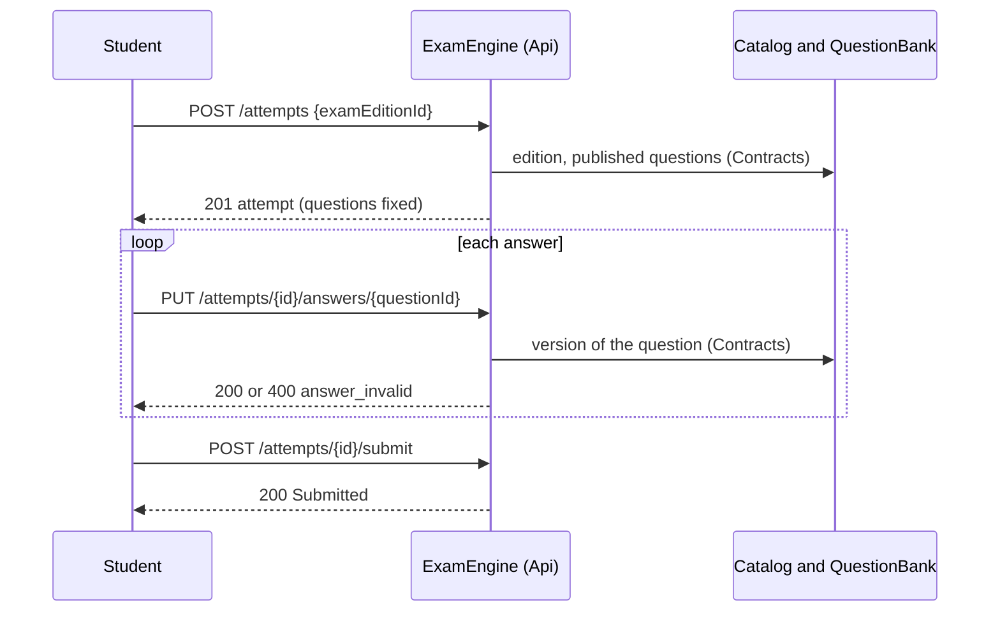

# Starting, answering and submitting an exam attempt

Technical terms: [glossary](../glossary.md)

## Trigger
A signed-in `Student` (permission `attempts.take`) calls `POST /api/v1/exam-engine/attempts` with the id of a published exam edition. The simulator screen (F-169, [Taking an exam edition](take-exam-edition.md)) drives these calls; the timer comes later (epic E-06).

## Steps
1. `POST /api/v1/exam-engine/attempts` with `{ "examEditionId": "<id>" }` → 201 with the attempt, or 200 with the one already in progress on that edition (`StartAttemptHandler`).
2. The handler asks `IAttemptSource` (adapter over `IExamEditionDirectory` and `IPublishedQuestionDirectory`) for the edition and its published questions. A draft or unknown edition answers 404 `exam_attempt.edition_not_found`; an edition with no published question answers 422 `exam_attempt.edition_without_questions`.
3. `Attempt.Start` fixes the questions: one `attempt_answers` row per published question in paper-number order, each with the question id, its paper number and the number of its latest `QuestionVersion`. Editing, annulling or unpublishing a question later never changes it.
4. `GET /api/v1/exam-engine/attempts/{id}` → the state, the questions (id, paper number, version, type) and the student's own answers. Never a statement, key, explanation or model answer.
5. `PUT /api/v1/exam-engine/attempts/{id}/answers/{questionId}` with a body carrying a `type` member (`SingleChoice`, `TrueFalse`, `MultipleAnswer`, `Matching`, `FillInTheBlanks`, `ShortAnswer`, `OpenAnswer` or `Essay`) → 200 with the question and its answer. `AnswerChecker` checks it against the version the attempt fixed; nothing is stored when it finds anything.
6. `DELETE /api/v1/exam-engine/attempts/{id}/answers/{questionId}` → 204; the question is blank again (also when it already was).
7. `POST /api/v1/exam-engine/attempts/{id}/submit` → 200 with the attempt `Submitted` and the server's time. Blank questions stay blank.
8. `GET /api/v1/exam-engine/attempts/{id}/content` (F-169) → what the student reads: each question at the version the attempt fixed (type, content language, statement, base text, options by position, notice subject, the student's answer), the sections (one per notice subject, ordered by their lowest paper number, the questions with none last) and the edition. `GetAttemptContentHandler` reads it through `IAttemptSource` over `IPublishedQuestionDirectory.ListVersionContentAsync`, a projection with no key, explanation or rubric, and rewrites each picture address `/question-images/{imageId}` to `/attempts/{id}/images/{imageId}`. Also answered on a submitted attempt.
9. `GET /api/v1/exam-engine/attempts/{id}/images/{imageId}` (F-169) → the picture, with its stored type, `nosniff`, `sandbox` and `private`, when a version the attempt fixed holds it in its statement, base text or options (`IPublishedQuestionDirectory.OpenVersionImageAsync`: one `EXISTS ... LIKE` over the attempt's own versions). The Web route `/attempts/{id}/images/{imageId}` streams it with the user's token.

## Rules
- A student has at most one attempt in progress per edition (a partial unique index, `NULLS NOT DISTINCT`); starting again returns it, also for two starts at the same moment. After a submit a new attempt can start; there is no limit on submitted ones.
- An answer has the shape of its type; options and matching items are told by their position in the question's version, counted from 0, and blanks by their number.
  - `SingleChoice` one option; `TrueFalse` true or false; `MultipleAnswer` one or more options; `Matching` for each left item at most one right option (an item named twice is refused); `FillInTheBlanks` a text for each blank number of the version; `ShortAnswer` a text; `OpenAnswer` a text of at most the question's size in characters; `Essay` a text of at most the question's size in lines.
  - A text is at most 20,000 characters whatever the type, is kept as written and has `\r\n` and `\r` made `\n`. The minimum lines of an essay is not checked: it is judged at grading.
- The checks run in an order a caller can tell apart: the attempt is the caller's (404 `exam_attempt.not_found`), the question is one of it (404 `exam_attempt.question_not_in_attempt`), the attempt takes answers (409 `exam_attempt.already_submitted`), the answer fits (400 `exam_attempt.answer_invalid` with `errors: [{ field, code }]`).
- A submitted attempt never changes. Submitting it again answers 200 with the original time; saving or clearing answers 409. The submission time is the server's clock, whatever the body or headers say.
- A save takes a shared row lock on the attempt and a submit an exclusive one, so a save that was answered 200 is stored before the submit and one that arrives after it answers 409. Two saves to one question at once: the last wins, with no concurrency token.
- Only the owner reads and changes an attempt; anyone else gets the answer of an id that does not exist (404 `exam_attempt.not_found`). A user holding `attempts.read` (`Admin` only) reads any attempt through step 4 and changes none. The content and picture routes (steps 8 and 9) are the owner's only: another student, an `Admin` and an unknown id get the same 404 `exam_attempt.not_found`, as does a picture no fixed version holds.
- The body of a save is read in the endpoint up to `AttemptLimits.SaveBodyMaxBytes`; above it the answer is 413.
- Rows carry the `TenantId` of `ICurrentTenant` (null until F-162); the tenant filter of the module's context hides another tenant's attempt, so no query ignores it.
- The answer column is `json`, not `jsonb`: `jsonb` reorders the members of an object and the polymorphic read needs `type` first.

## Wireframe
The screens that drive these calls (F-169) are drawn in [Taking an exam edition](take-exam-edition.md#wireframe).
Mockup: ../features/mockups/F-169-take-exam-edition.html

## Errors
- `exam_attempt.edition_not_found` — 404 the edition is a draft or unknown, or 400 no edition was sent.
- `exam_attempt.edition_without_questions` — 422 the published edition has no published question.
- `exam_attempt.not_found` — 404 the attempt does not exist or is another student's; on the content and picture routes also for an `Admin`, and for a picture no version of the attempt holds.
- `exam_attempt.question_not_in_attempt` — 404 the question is not one of the attempt.
- `exam_attempt.answer_invalid` — 400 the answer does not fit; each entry of `errors` has a `field` and one of `answer_type_mismatch`, `option_unknown`, `item_unknown`, `blank_unknown`, `text_too_long`, `answer_empty`, `entry_repeated`.
- `exam_attempt.already_submitted` — 409 a save or a clear on a submitted attempt.
