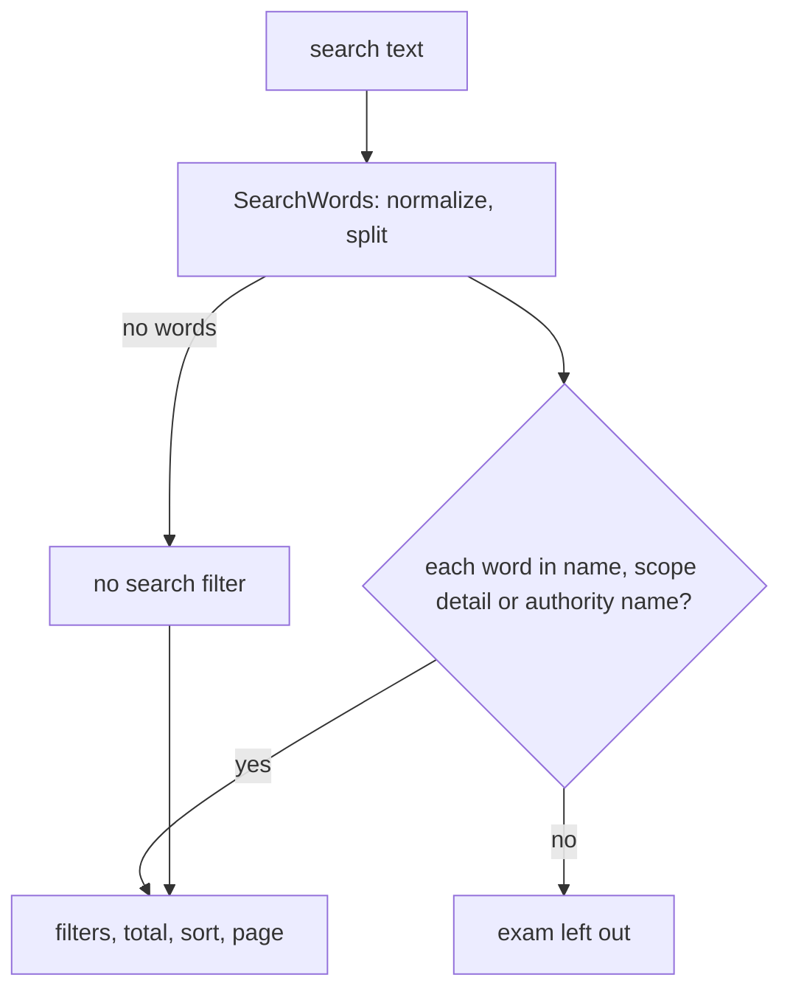

# Search the back-office exam list

Technical terms: [glossary](../glossary.md)

Manual page for the user: [Exams](../manual/pt-BR/exams.md)

## Trigger
An editor holding `catalog.manage` types in the search box of `/admin/exams`, or a client calls `GET /api/v1/catalog/exams?search=<text>`.

## Steps
1. The page sends the text as `search` after the table's debounce, with the filters and the paging it already sends.
2. `ExamQueries.ListAsync` turns the text into words with `CatalogText.SearchWords`: normalized (trimmed, upper-cased, accents removed), split on whitespace, no empty word.
3. For each word the query keeps the exams where the word is inside the exam's normalized name, **or** inside its normalized scope detail, **or** inside the normalized name of its issuing authority (an `Any` over `IssuingAuthorities`, so a deleted authority is never read).
4. The authority, type, scope and state filters apply with AND; `total` counts the exams that survived all of it; the sort and the page come last.
5. The student catalog (`PublishedExamQueries`) uses the same `SearchWords`, so the two lists cannot drift apart.



## Rules
- Every word must be found in at least one of the three fields; different words may be found in different fields (`guarda sao paulo`).
- Blank or whitespace-only text is no filter.
- For a `State` exam the scope detail holds the state's name and acronym, so `sp` and `sao paulo` find it. A `National` exam has no scope detail.
- The authority's stored acronym and the edition's organizer are not searched (F-44 BR5).
- Behavior that changed (BR5): the words of a name no longer have to be contiguous. `judicial tecnico` finds "Tecnico em Avaliação Judicial"; before, only the exact run of characters did.

## Wireframe
```text
+----------------------------------------------------------+
| Exams                                           [ + Add ] |
| [changed] [ Search by exam, authority or place ______ ]   |
| Authority [__] Type [All v] Scope [All v] State [____]    |
| Name              | Authority        | Type   | Scope      |
| ...                                                      |
+----------------------------------------------------------+
```

## Errors
- None added. `search` stays optional; a student without `catalog.manage` still gets `403`.
