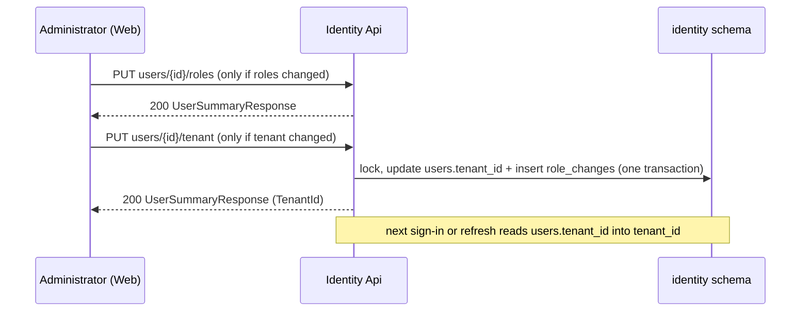

# Grader role and the user's tenant

Technical terms: [glossary](../glossary.md)

## Trigger
- The app starts: the Identity seed creates the system role `Grader` and the permission `questions.grade`.
- An administrator (any holder of `identity.roles.manage`) opens `/admin/users`, edits a user's access and saves.
- A user signs in or refreshes a token.

## Steps
1. At start, `EnsureRolesAndPermissionsAsync` creates every name of `IdentityRoles.All` as a system role (`Grader` among them) and every permission the module catalogs declare. `QuestionBankModule` declares `questions.grade` with the initial grant to `Grader`; the grant is applied only in the start that creates the permission row, and Admin is given every permission at every start.
2. In the access dialog of `/admin/users`, the administrator ticks roles and pastes a tenant id (or clears the field).
3. On save, the dialog sends `PUT /api/v1/identity/users/{id}/roles` first, and only when the roles changed.
4. Then it sends `PUT /api/v1/identity/users/{id}/tenant` with `SetUserTenantRequest { TenantId }`, only when the tenant changed.
5. `SetUserTenantHandler` runs inside the role-administration lock (`RunExclusiveAsync`): it loads the tracked `User`, refuses an unknown or deleted account (404) and the empty GUID (400), calls `User.AssignTenant`, stages `RoleChange.UserTenantChanged` and saves both in one transaction.
6. The answer is the `UserSummaryResponse` of the user, with `TenantId`; the list reloads and shows the first 8 characters of the tenant.
7. At the next sign-in or refresh, `TokenEndpoints` builds the claim `tenant_id` from the stored `User.TenantId`. An access token lives 15 minutes, so the change reaches the user within that time; no session is ended.



## Rules
- `Grader` is a system role: it cannot be renamed or deleted; its permissions change in `/admin/roles`.
- Nothing requires `questions.grade` yet: a user whose only role is `Grader` sees what a Student sees until the correction queue (F-151).
- Any account that is not deleted can have a tenant. There is no `Tenant` entity: any non-empty GUID is accepted.
- The user entity has no tenant query filter (F-150 change note v2): an account with a tenant signs in, refreshes and is listed. `ICurrentTenant` stays `NoTenant`; nothing is filtered by tenant yet (F-162).
- The value already stored answers 200 and writes nothing, not even an audit entry.
- The audit entry `UserTenantChanged` holds the former tenant in `Removed` and the new one in `Added`; it has no role, so the role filter of `/admin/role-history` never lists it. Filter by user to find it.
- The audit entry itself stays global (`TenantId` null), so a global administrator keeps seeing it once tenant filters wake up.
- An erased account keeps its `TenantId`: it identifies an organization, not a person.
- The token claim is read from the store only; a `tenant_id` sent with a token request is ignored. OpenIddict drops a claim whose value is empty, so an account with no tenant has no `tenant_id` claim.

## Wireframe
```text
+----------------------------------------------------------+
| Access of ana@example.com [changed]                      |
+----------------------------------------------------------+
| (i) A user can hold several roles; their permissions add |
|     up. The user's menu changes on their next page load. |
|                                                          |
| [x] Student    ...                                       |
| [ ] Curator    Manage the question bank, Review ...      |
| [x] Grader [new]   Grade questions                       |
| [ ] Admin      ...                                       |
|                                                          |
| Tenant [new]                                             |
| [ 3f2a9c10-7b1e-4c55-9d2e-0a1b2c3d4e5f ____________ ]    |
| Paste the tenant id; leave empty for none.               |
|                                                          |
|                              [ Cancel ]  [ Save ]        |
+----------------------------------------------------------+
```

```text
+----------------------------------------------------------+
| Users                                      [ Search ___ ]|
+----------------------------------------------------------+
| Email           | Name | Status | Roles    | Tenant [new] |
| ana@example.com | Ana  | Active | Grader   | 3f2a9c10     |
| bia@example.com | Bia  | Active | Student  | —            |
+----------------------------------------------------------+
```

## Errors
- `user.tenant_invalid` — 400: the tenant is the empty GUID. A value that is not a GUID at all is the framework's 400, with no code; the dialog refuses both before sending.
- `user.not_found` — 404: the account does not exist, is deleted or was erased.
- `identity.forbidden` — 403: the caller does not hold `identity.roles.manage`.
- When the roles were saved and the tenant request fails, the dialog stays open with the error and a "Roles of … saved." message; a second save sends only the tenant.
