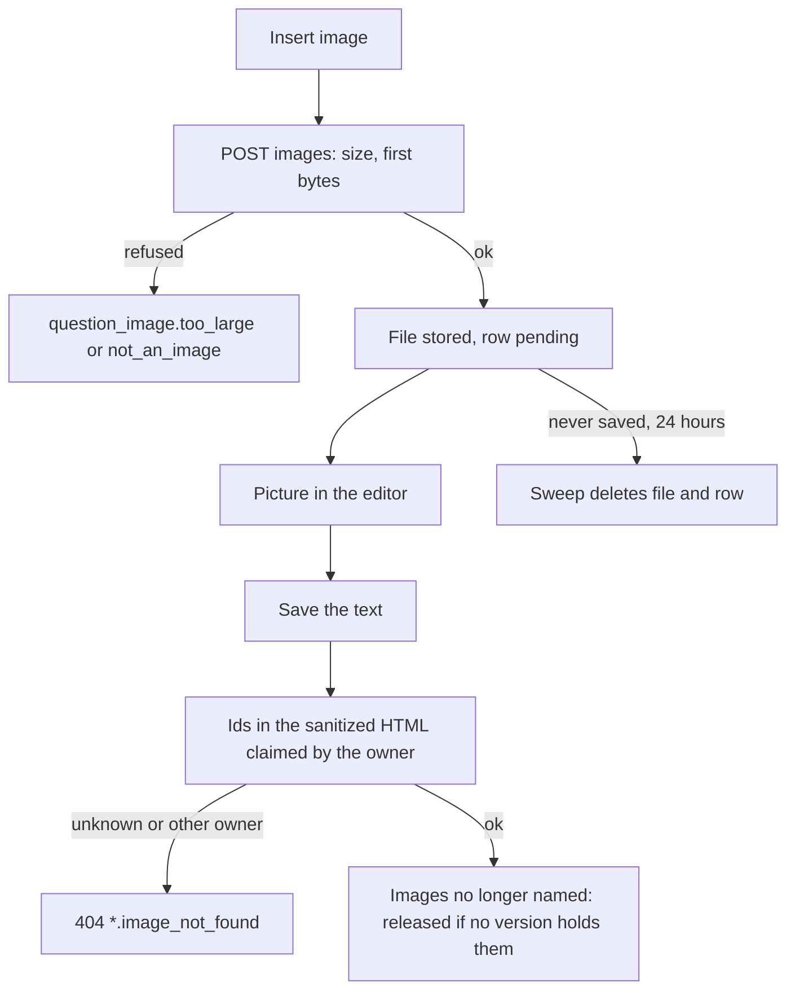

# Put images in questions

Technical terms: [glossary](../glossary.md)

## Trigger
A curator holding `questions.manage` writes a statement or an option at `/admin/questions/{id}`, or the text of a base text at `/admin/base-texts/{id}`, and presses **Insert image** in the editor's toolbar. A reviewer holding `questions.review` sees the pictures in the preview and in the review screen.

## Steps
1. The curator presses **Insert image**. The kit's `AppRichTextImageDialog` asks for a file (PNG, JPEG, WebP or GIF, up to 2 MB), shows a preview built in the page, and asks for the alternative text (up to 250 characters) or the **Decorative image** mark.
2. **Insert** sends the bytes through the page's `RichTextImageOptions.Upload` to `POST /api/v1/question-bank/images` (multipart, one part named `file`). The Api checks the size, decides the type from the first bytes, stores the file as `question-images/{guid}` through `IQuestionImageFiles` and writes a row in `question_bank.question_images` with no owner: the image is **pending**. The answer is `201` with `Id`, `Url` (`/question-images/{id}`), `ContentType` and `SizeBytes`.
3. The editor inserts the picture at the caret with that `Url` and the alternative text. A file pasted or dropped into the editor inserts nothing: only the dialog does.
4. Saving the question or the base text sends the HTML as before. The Api sanitizes it (`img` stays only with a `src` of exactly `/question-images/{guid}`, keeping `src` and `alt`), reads the image ids in it, and `QuestionImageOwnership` claims each one for the question (statement and options together) or the base text, in the same save as the content. The explanation takes no picture: its `img` are dropped.
5. A picture the saved text no longer names is released: when no stored version of the owner holds its id (for a base text, no version of any question), the row is soft-deleted in the save and the file is deleted after the commit. A published question's earlier version keeps pointing at it, so the file stays.
6. `GET /api/v1/question-bank/images/{id}` streams the file to a holder of `questions.manage` or `questions.review` (checked in the endpoint through `IPermissionQueryService`). The browser reaches it through the Web route `GET /question-images/{id}`, which calls the Api with the signed-in user's token. Neither answer carries a storage address.
7. Every hour a hosted service of the module (`QuestionImageSweepWorker`, switch `QuestionBank:ImageSweepEnabled`) deletes the pending images older than 24 hours: the file first, then the row.



## Rules
- Images go in the statement, the base text and the options (not the explanation, the base text title or the change reasons).
- At most 10 images per question (statement and options together) and 10 per base text, counted in the stored HTML (`*.images_too_many`).
- Every picture has an `alt` attribute; an empty one marks a decorative picture. A missing one is `*.image_alt_required`, one over 250 characters `*.image_alt_too_long`.
- A text that holds only a picture is not empty; the plain text (list excerpt, search) carries the alternative text of the non-decorative pictures.
- The response of a picture carries the stored content type, `X-Content-Type-Options: nosniff`, `Content-Security-Policy: sandbox` and `Cache-Control: private`.
- A published version copies the HTML as it is, so it keeps its pictures (F-98, F-102). Soft-deleting a question or a base text keeps its files.

## Wireframe
```text
+--------------------------------------------------------+
| Insert image [new]                                  X  |
+--------------------------------------------------------+
| Image *                                                |
| [ Choose image ]  map-of-brazil.png  (184 KB)          |
| PNG, JPEG, WebP or GIF, up to 2 MB                     |
| +----------------------------------------------------+ |
| |                  (preview)                         | |
| +----------------------------------------------------+ |
| Alternative text *                                     |
| [ Map of Brazil with the five regions coloured      ]  |
| [ ] Decorative image (no alternative text)             |
|                                                        |
|                        [ Cancel ]   [ Insert ]         |
+--------------------------------------------------------+
Error: "File is not a PNG, JPEG, WebP or GIF image" under
the file field; "Alternative text is required" under the text.
```

```text
+--------------------------------------------------------+
| Statement *                                            |
| [B][I][U][S][x2][x2][link][image] [changed]            |
| +----------------------------------------------------+ |
| | Look at the map and answer:                        | |
| | +------------------------------+                   | |
| | | (image, scaled to the column)|                   | |
| | +------------------------------+                   | |
| +----------------------------------------------------+ |
| Options                                                |
| (A) [B][I][link][image] [changed]  [ (image) ]         |
+--------------------------------------------------------+
```

## Errors
- `question_image.not_an_image` — the file is not a PNG, JPEG, WebP or GIF image (400).
- `question_image.too_large` — the file is over 2 MB (400).
- `question_image.not_found` — the image is unknown, deleted, or its file is gone (404).
- `question.image_alt_required`, `question.image_alt_too_long`, `question.images_too_many` — on saving a question (400).
- `question.image_not_found` — the HTML names an image that does not exist or belongs to another owner (404).
- `base_text.image_alt_required`, `base_text.image_alt_too_long`, `base_text.images_too_many`, `base_text.image_not_found` — the same four on saving a base text.
