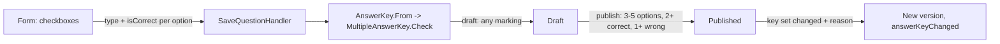

# Author and publish a multiple-answer question

Technical terms: [glossary](../glossary.md)

Manual page for the user: [Questions](../manual/en/questions.md)

## Trigger
A curator with `questions.manage` opens `/admin/questions/new`, chooses the type card **Multiple answer** and fills the form; later saves it, publishes it and edits it at `/admin/questions/{id}`. The type is fixed after the first save.

## Steps
1. The form shows checkboxes in the Options section instead of the radio group; any number of them may be checked on a draft.
2. Save sends `type = MultipleAnswer` and every option with its `isCorrect` to `POST /api/v1/question-bank/questions` (`PUT .../{id}` to edit). No true/false key is sent.
3. `SaveQuestionHandler` builds the content; `AnswerKey.From(type, options, trueFalseKey)` returns a `MultipleAnswerKey`, and `Question.Create` / `Update` call its `Check`.
4. Publish (`POST .../{id}/publish`) runs `Check(published: true)` again: three to five options with text, at least two correct and at least one wrong.
5. Editing a published question runs the same check and then `Question.NextVersion`: it compares the set of correct positions with the latest version's, so any change of which options are correct needs the reason.
6. The preview derives "Mark {N} options" from the count of correct options and reveals the marked ones after "show answer".



## Rules
- The number of correct options is the count of the marks; nothing is stored beside them, and no scoring mode, penalty or score exists on the question (epic E-6 owns scoring).
- The type never changes: another type on an update is 409 `question.type_changed`.
- A true/false key sent with this type is 400 `question.key_not_allowed`; options on a true/false question stay 400 `question.options_not_allowed`.
- A sixth option is `question.options_count` on a draft too; fewer than three to publish is `question.multiple_options_count`.
- The rules the types share (sanitizing, limits, status, delete, topic guard, origin, annulment, permission) are the same rules: they live outside the key.
- A later type adds a record beside `MultipleAnswerKey`, one line in `AnswerKey.From`, a card in the form and a block in the preview; the entity never branches on the type.

## Wireframe
```text
+--------------------------------------------------------+
| Classification                                         |
|  Question type: ( ) Single choice  ( ) True/false      |
|                 (x) Multiple answer            [new]   |
+--------------------------------------------------------+
| Options                                        [changed]|
| 3 to 5 options to publish. Mark every correct one:      |
| at least two, and at least one wrong.                   |
|  [A] [x] Option text ........................ ^ v x    |
|  [B] [ ] Option text ........................ ^ v x    |
|  [C] [x] Option text ........................ ^ v x    |
|  [+ Add option]                       3 of 5 options    |
|  ! At least two correct and one wrong. (error)          |
+--------------------------------------------------------+
| Before publishing: [v] 3 to 5 options                   |
|   [v] Every option has text  [ ] 2+ correct, 1+ wrong   |
+--------------------------------------------------------+
```

```text
+------------------------------------------+
| Preview                                  |
| <base text>                              |
| <statement>                              |
| Mark 2 options.                  [new]   |
|  A. Option text                          |
|  B. Option text                          |
|  C. Option text                          |
| [ Show answer ]                          |
|  -- after reveal --                      |
|  A. Option text   (v) Correct answer     |
|  C. Option text   (v) Correct answer     |
| Explanation: <text>                      |
+------------------------------------------+
```

## Errors
- `question.multiple_options_count` — 400 on publish (or an edit of a published question) with fewer than three options.
- `question.multiple_key_invalid` — 400 on publish (or such an edit) with fewer than two correct options, or with every option marked correct.
- `question.key_not_allowed` — 400 when a true/false key comes with this type.
- `question.type_changed` — 409 when an update names another type.
- `question.key_change_reason_required` — 400 when the set of correct options changed on a published question and no reason came.
