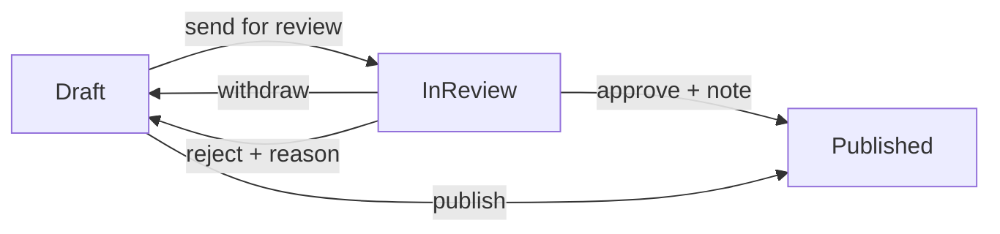

# Review before publishing

Technical terms: [glossary](../glossary.md)

## Trigger
A curator with `questions.manage` opens a saved, complete draft at `/admin/questions/{id}` and presses **Send for review** (the second way to publish; **Publish** stays as it was). A reviewer with `questions.review` opens the **Review queue** at `/admin/questions/review`, picks a question and decides at `/admin/questions/review/{id}`. Both permissions are checked by the endpoint and by the screen (menu, page), never by role name; `Curator` and `Admin` hold both.

## Steps
1. The curator presses **Send for review**: `POST /api/v1/question-bank/questions/{id}/submit`. The handler calls `Question.Submit()`, which runs the same completeness check as publishing, sets `InReview` and returns a `Submitted` `QuestionReviewEntry`; the status and the entry are one save. No version is made.
2. While the question is `InReview` it is frozen: save, publish, unpublish and delete answer `question.in_review`; reading, listing, previewing and the version history still work. A curator may withdraw it (`POST .../withdraw`, any holder of `questions.manage`, no reason): it is a draft again with a `Withdrawn` entry.
3. The reviewer opens the queue (`GET /api/v1/question-bank/review-queue`): the questions in review, oldest latest send first, zero-based pages capped at 100, no search or filter.
4. The review screen reads `GET .../review-queue/{id}` (a `QuestionResponse`, with `SubmittedAt` while in review; a question that is not in review answers 409 `question.not_in_review`) and shows the question as a student sees it, with the key and the explanation always shown, and the classification beside it. Nothing there edits content.
5. **Approve** (`POST .../review-queue/{id}/approve`, optional note) publishes it exactly as a direct publish does: the same completeness check, status `Published` and the version F-98 makes (the note is also the reason of the version when the answer key moved since the latest one); an `Approved` entry holds the trimmed note. **Reject** (`POST .../reject`, required reason) makes it a draft again with a `Rejected` entry; there is no `Rejected` status. Both send the `SubmittedAt` the reviewer saw.
6. The curator sees the rejection reason in the Publication card (while the latest entry is that rejection) and the whole history in the **Review history** card (`GET .../questions/{id}/reviews`, oldest first, shown newest first), fixes the draft and sends it again.



## Rules
- Sending needs a `Draft` and the content publishing needs; an incomplete draft answers the publish codes (400), `InReview`, `Published` and `Annulled` answer `question.already_in_review`, `question.already_published` and `question.annulled` (409).
- Withdrawing, approving and rejecting need an `InReview` question (`question.not_in_review`, 409). The state is judged before the note or the reason; the reason of a rejection is required and a note or reason is at most 500 characters after trimming (`question.review_reason_required`, `question.review_reason_too_long`, 400).
- Every change of status carries the original status in its UPDATE (it is the concurrency token), and the review entry is written in the same `SaveChanges`: two decisions at once, or a decision against a withdrawal, are one winner and one 409 `question.version_conflict`. A save of a draft that changes only options marks the status as guarded, so a draft that went into review meanwhile is a lost race and not a silent rewrite.
- A decision that sends a `SubmittedAt` other than the latest `Submitted` entry's (withdrawn, edited and sent again while the reviewer read it) answers 409 `question.version_conflict`; leaving it out skips the check.
- The person who sent a question may approve it; both entries carry their user id (the audit `CreatedBy`). No names are shown: the module cannot turn an id into a name.
- Annul keeps its own rule: a question in review answers `question.not_published`. Editing a published question stays direct, with no review (F-123 records the idea).
- The review history is append-only (`question_bank.question_review_entries`): there is no route that edits or deletes an entry.
- `questions.review` is seeded to `Curator` through the module's `PermissionCatalog.InitialGrants`, applied by Identity in the start that creates the permission row; `Admin` has every permission. The row and the grant are added in the same commit.

## Wireframe
#### Question form, Publication card
```text
+--------------------------------------------------------+
| Publication                                            |
| [Draft]  Draft. Not available outside the back office. |
| [ Preview ] [ Send for review ] [new]  [ Publish ]     |
| Save your changes first.          (one reason, both)   |
+--------------------------------------------------------+

+--------------------------------------------------------+
| (!) This question is in review and cannot be edited.   |
|     Withdraw it from review to change it.        [new] |
+--------------------------------------------------------+
| Publication                                            |
| [In review] [new]  In review. Waiting for a reviewer   |
|                    since 16/10/2026 14:02.             |
| [ Preview ] [ Withdraw from review ] [new]             |
+--------------------------------------------------------+

+--------------------------------------------------------+
| Publication                                            |
| (i) Rejected on 17/10/2026 09:15: The key of option C  |
|     contradicts the explanation.                 [new] |
| [Draft]  Draft. Not available outside the back office. |
| [ Preview ] [ Send for review ]  [ Publish ]           |
+--------------------------------------------------------+

+--------------------------------------------------------+
| Review history                                   [new] |
| Date             | Event      | Reason or note         |
| 17/10/2026 09:15 | [Rejected] | The key of option C... |
| 16/10/2026 14:02 | [Sent]     | —                      |
+--------------------------------------------------------+
```

#### Review queue
```text
+------------------------------------------------------------------------+
| Content / Review queue                                                 |
| Review queue                                                     [new] |
+------------------------------------------------------------------------+
| Statement             | Topic          | Type   | Language | Sent on   | |
| Acerca dos direitos…  | Direitos fund. | Single | pt-BR    | 16/10 14:02 | [Review]
|  (link)               |  Direito Const.|        |          |           | |
| Read the text and…    | Reading        | Multi  | English  | 16/10 15:40 | [Review]
+------------------------------------------------------------------------+
| (inbox)  Nothing is waiting for review.            (empty state) [new] |
+------------------------------------------------------------------------+
```

#### Review screen
```text
+--------------------------------------------------------------+--------------------+
| Content / Review queue / Review question                      | Summary            |
| Review question                                         [new] | Status [In review] |
+--------------------------------------------------------------+ Subject  Direito…  |
| CEBRASPE · PRF 2024 · Policial Rodoviário   Question 12       | Topic    Direitos… |
| (base text)                                                   | Language pt-BR     |
| Statement ...                                                 | Difficulty 3       |
| A) ...   B) ...   [C) ... (v) Correct answer]   D) ...  E) ...| Type     Single    |
| ------------------------------------------------------------- | Source   CEBRASPE… |
| ANSWER  C                                                     | Sent on  16/10 …   |
| EXPLANATION ...                                               |                    |
+--------------------------------------------------------------+--------------------+
|                                   [ (x) Reject ]  [ (v) Approve ]                  |
+------------------------------------------------------------------------------------+

no longer in review:
+------------------------------------------------------------+
| (!) This question is no longer in review: another reviewer |
|     decided it, or it was withdrawn.                       |
| Back to the queue                                          |
+------------------------------------------------------------+
```

#### Reject and Approve dialogs
```text
+----------------------------------------------+   +----------------------------------------------+
| Reject this question?                  [new] |   | Approve this question?                 [new] |
| It goes back to draft with your reason,      |   | It is published at once and practice can use |
| which the curator sees on the question's page|   | it. A note is optional and stays in the      |
| Reason *                                     |   | review history.                              |
| [__________________________________________] |   | Note                                         |
| Required. Plain text, up to 500 chars. 0/500 |   | [__________________________________________] |
|                    [ Cancel ]  [ Reject ]    |   | Optional. Plain text, up to 500 chars. 0/500 |
+----------------------------------------------+   |                    [ Cancel ]  [ Approve ]   |
                                                   +----------------------------------------------+

typing, at the limit, over the limit (the Api's 400):
| Required. Plain text, up to 500 characters.                            137/500 |
| Required. Plain text, up to 500 characters.                            500/500 |
| The reason or note has more than 500 characters.                       512/500 |
```

Mockup: ../features/mockups/F-105-review-before-publishing.html

## Errors
- `question.in_review` — save, publish, unpublish or delete of a question in review (409).
- `question.already_in_review` — sending a question that is already in review (409).
- `question.not_in_review` — withdraw, approve, reject or the review detail of a question that is not in review (409).
- `question.review_reason_required` — a rejection with a missing or blank reason (400).
- `question.review_reason_too_long` — a rejection reason or an approval note over 500 characters (400).
- `question.version_conflict` — a lost race between two writes of the same question, or a decision on a send that is no longer the latest (409).
- `question.key_change_reason_required` — an approval whose answer key differs from the latest version's and carries no note (400).
