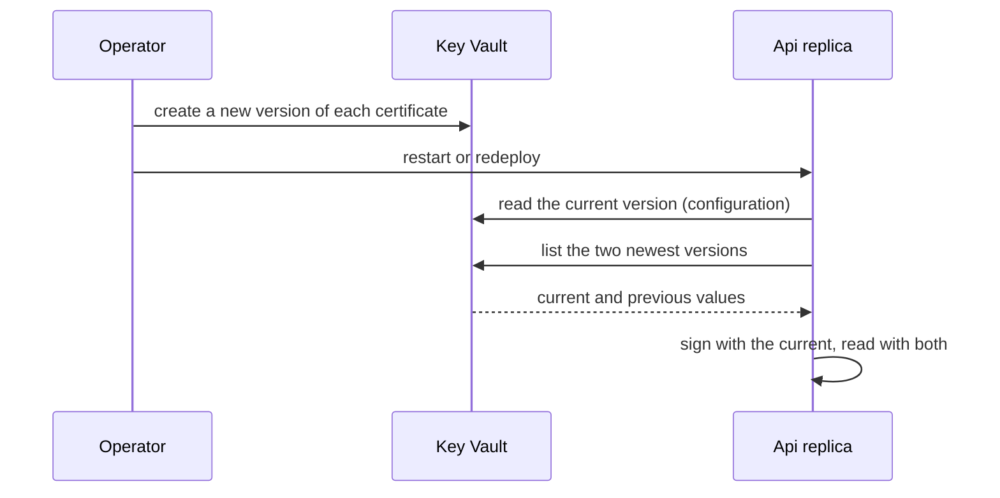

# Rotating the OpenIddict certificates without signing users out

Technical terms: [glossary](../glossary.md)

The renewal commands and the first-deploy steps are in [infra](../infra.md), step 7, "Renewing the OpenIddict certificates".

## Trigger
An operator renews the signing and encryption certificates in Key Vault before their 24 months end (F-73), or cuts an old or compromised certificate off.

## Steps
1. The operator creates a new version of each certificate from the committed policy (`az keyvault certificate create ...`). The private key never leaves the vault.
2. The operator restarts or redeploys the `api`.
3. At start the Api reads the current version of each certificate as configuration (F-64) and, outside Development with a vault connection, lists the two newest versions of each certificate with its own identity.
4. The Api keeps the version immediately before the current one as the previous certificate when it is enabled, loads fine and expires earlier than the current one.
5. OpenIddict signs and encrypts with the certificate that expires last (the current one) and validates and decrypts with every certificate it holds, so a token made before the renewal is still read.
6. The Api logs, at `Information`, the thumbprints of the current and previous certificate of each role.

## Rules
- The previous certificate is the version immediately before the current one, by creation date, and only when it is enabled. A disabled previous version means no previous certificate; an older enabled version is never promoted in its place.
- The Api takes the current and the previous from one listing and loads the previous only when the newest listed version holds the same value as the current one it read as configuration; if a renewal landed between the two reads it starts with the current only and warns.
- A previous certificate that is not a PKCS#12 file, has no private key, lacks the key usage, is expired, is not valid yet or does not expire earlier than the current one is ignored with a warning that names the vault certificate and the reason, never the value. The current certificate keeps the strict start check of F-73.
- If the versions cannot be listed (permission, network, no answer within 10 seconds) the Api starts with the current certificates and warns.
- Previous certificates come only from the vault, through the Api's code: no configuration key or environment variable adds a trusted certificate.
- The overlap runs from the create command until every `api` replica has restarted. A replica that still holds only the old certificate refuses a token made with the new one, and the Web ends the session of that user when the Api answers 401 or `invalid_grant`. So "no mass sign-out", never "no sign-out at all".
- The previous certificate stays trusted until the next renewal, when it stops being the immediately previous version.

## Cut-off of an old certificate
1. Disable the version in the vault (`az keyvault certificate set-attributes ... --version <version> --enabled false`).
2. Restart the `api`. Disabling the previous version removes it at that start and the tokens it made stop working; disabling the current version stops the start (F-73).

## Errors
- Nothing reaches a caller: a fault in a previous certificate or in the listing is a `Warning` in the log of the `api` (`OpenIddict previous certificate '<name>' ignored: <reason>`), and the Api starts with the current certificates.
