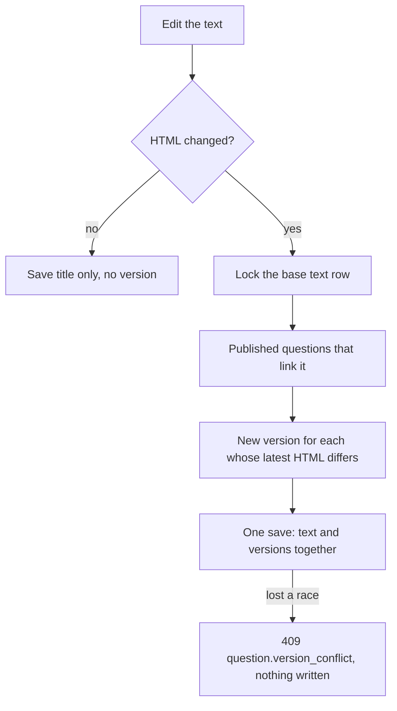

# Share a base text between questions

Technical terms: [glossary](../glossary.md)

Manual page for the user: [Questions](../manual/en/questions.md)

## Trigger
A curator holding `questions.manage` opens **Content / Base texts** (`/admin/base-texts`) and presses **Add**, or opens a question at `/admin/questions/{id}` and picks a base text in its **Base text** section.

## Steps
1. The curator writes a base text at `/admin/base-texts/new`: a title (1 to 200 characters), a content language and the text in the visual editor. `POST /api/v1/question-bank/base-texts` sanitizes the HTML and stores it.
2. In the question form, the picker asks `GET /api/v1/question-bank/base-texts?language=<the question's language>` as the curator types and offers only texts in that language. Saving the question sends `BaseTextId`; sending `null` removes the link.
3. A question with a link shows the text before its statement (preview, student view). The question response carries `BaseText` (id, title, HTML); the question itself stores only the id.
4. Editing the text at `/admin/base-texts/{id}` sends `PUT .../base-texts/{id}`. When the sanitized HTML changed, the handler reads the live questions that link the text and are `Published`, takes each one's latest version, and adds a new version (same content, the new HTML, not an answer key change, no reason) to every one whose latest version holds other HTML. All of it is one save.
5. Deleting is `DELETE .../base-texts/{id}`: refused while any live question links the text.
6. In transcription mode the chosen base text stays chosen after "Save and continue", with the edition, the notice subject and the content language.



## Rules
- A question has at most one base text, held by `base_text_id` (a foreign key inside the module that restricts a hard delete). A question never carries text of its own.
- The question and its base text are in the same content language. A language that differs is `question.base_text_language_mismatch` (409); the language of a text that questions link cannot change (`base_text.language_in_use`, 409).
- A version still copies the base text HTML (F-98): what a student was shown stays what the version says, and a version already recorded is never touched.
- A draft follows the live text and makes no version; an annulled question is frozen (F-101) and makes none. A reinstated question gets back the HTML its latest version holds; its next save makes a version with the live text.
- A base text that a live question links, of any status, is never deleted (`base_text.in_use`, 409). A text with no question is soft-deleted.
- The row of the base text is locked while it matters: the edit and the delete take `FOR UPDATE`; a question save or a publish that links the text takes `FOR SHARE` until its own save. A delete or an edit that starts meanwhile waits for it, so it sees the link, or the question it just published.
- The status of every question versioned by an edit is checked at the save (it is the concurrency token): a question unpublished or annulled since it was read makes the whole save `question.version_conflict`.
- The migration gives each question that had an inline text a base text of its own (title: the first 80 characters of the plain text), soft-deleted when the question was, and drops the inline column. It writes no version. Its `Down` copies the text back into the questions and loses the titles and the sharing.

## Wireframe
### Base texts
```text
+----------------------------------------------------------------------+ [new]
| Content / Base texts                                                 |
| Base texts                                                 [ + Add ] |
| [Q Search by title_____________________]  LANGUAGE [All languages v] |
| TITLE                                   LANGUAGE        QUESTIONS    |
| Caso clinico - UBS do bairro Esperanca  Portugues (Br.)         3  [edit][delete: off, "in use"]
| Grafico - Taxa de desemprego por regiao Portugues (Br.)         1  [edit][delete: off]
| Tabela de tarifas de energia 2025       Portugues (Br.)         0  [edit][delete]
| Text 1 - The Great Pacific Garbage Patch English                5  [edit][delete: off]
| Rows per page: 25                                      1-6 of 6      |
+----------------------------------------------------------------------+
```

### Base text
```text
+----------------------------------------------------------------------+ [new]
| Content / Base texts / Edit base text                                |
| Edit base text                                                       |
| +- Base text ------------------------------------------------------+ |
| | TITLE *                            CONTENT LANGUAGE *            | |
| | [Texto I - A barragem de Tres Marias] [Portugues (Brasil) v] off | |
| | Up to 200 characters...            Locked while questions use    | |
| |                                    this text (8)...              | |
| | (i) Saving a change to the text records a new version of each    | |
| |     published question that uses it; drafts and annulled ...     | |
| | TEXT *                                                           | |
| | [B I U S | x2 x2 | lists quote link | clear]                     | |
| | [ visual editor ...................................... ]        | |
| |                                          Cancel   [ Save ]       | |
| +------------------------------------------------------------------+ |
| +- Questions that use this text (8) -------------------------------+ |
| | STATEMENT                         SOURCE              STATUS     | |
| | De acordo com o texto, a barr...  FGV - CEMIG 2024    Published [edit]
| |                                   Question 12                    | |
| | O termo "cota", no terceiro ...   FGV - CEMIG 2024    Draft     [edit]
| +------------------------------------------------------------------+ |
| +- Delete this base text ------------------------------------------+ |
| | [ Delete ] (off)  Questions use this text (8). Remove their      | |
| |                   links before deleting it.                      | |
| +------------------------------------------------------------------+ |
+----------------------------------------------------------------------+
```

### Question form, base text section
```text
+----------------------------------------------------------------------+ [changed]
| Base text                                                            |
| A text shared by several questions, shown before the statement.      |
| BASE TEXT                                                            |
| [Q Texto I - A barragem de Tres Marias                         (x)]  |
|   picker open: Texto I - A barragem de Tres Marias                   |
|                Questions: 8 - changed on 10/14/2026                  |
|                Caso clinico - UBS do bairro Esperanca                |
|                Questions: 3 - changed on 10/02/2026                  |
| Only texts in Portugues (Brasil), the language of this question.     |
| Open the base text [->]     v Show the text                          |
| Not in the list? Create a base text [->]                             |
| It opens in a new tab, so this question stays as it is. Save the     |
| text there, come back and pick it here.                              |
| (i) after a language change: The base text "Texto I - ..." was       |
|     removed: it is in Portugues (Brasil), and this question is now   |
|     in English.                                                      |
+----------------------------------------------------------------------+
```

### Transcription, the base text kept
```text
+----------------------------------------------------------------------+ [changed]
| (ok) Question saved. Keep going.                                     |
| FGV - CEMIG 2024 - Analista          Question 4 of this session      |
| ...                                                                  |
| BASE TEXT                                                            |
| [Q Texto I - A barragem de Tres Marias                         (x)]  |
| Stays chosen for the next question. Change or remove it when the     |
| block of questions ends.                                             |
| STATEMENT * [ blank ]   TYPE, DIFFICULTY, KEY: blank                 |
|                                        Cancel  [ Save and continue ] |
+----------------------------------------------------------------------+
```

### Delete confirmation
```text
+--------------------------------------------+ [new]
| Delete item?                               |
| "Tabela de tarifas de energia 2025" leaves |
| the list and the question picker. No       |
| question uses it.                          |
|            Cancel  [ Delete this base text ] (error colour)
+--------------------------------------------+
```
Mockup: [F-102-shared-base-text.html](../features/mockups/F-102-shared-base-text.html)

## Errors
- `base_text.title_required`, `base_text.title_too_long`, `base_text.text_required`, `base_text.text_too_long`, `base_text.content_language_invalid` — a refused field of the base text form (400); nothing is stored.
- `base_text.not_found` — the text is unknown or deleted (404).
- `base_text.in_use` — a live question links the text (409): remove the links first.
- `base_text.language_in_use` — the language of a text that questions link cannot change (409).
- `question.base_text_not_found` — the question links a text that is unknown or deleted (404); the choice is cleared.
- `question.base_text_language_mismatch` — the question and the text are in different languages (409); the choice is kept so the curator sees which text was refused.
- `question.version_conflict` — an edit of the text lost a race with another save, an unpublish or an annulment (409): nothing was written, reload and try again.
