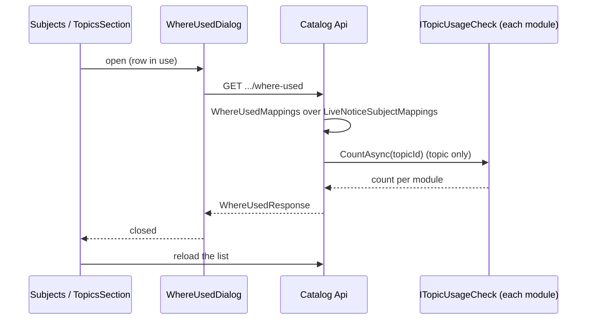

# See where a subject or topic is used

Technical terms: [glossary](../glossary.md)

Manual page for the user: [Subjects and topics](../manual/pt-BR/subjects.md)

## Trigger
A curator holding `catalog.manage` sees a disabled delete on a row of **Content / Subjects** (`/admin/subjects`) or of the **Topics** section of a subject page (`/admin/subjects/{id}`), and presses **Where used** beside it. The action exists only on a row whose `InUse` is true.

## Steps
1. The page opens `WhereUsedDialog` with the row's name in the title. The dialog reads the item when it opens, not from the list, because another curator may have released it since the list loaded.
2. A subject: `GET /api/v1/catalog/subjects/{id}/where-used` → `SubjectQueries.WhereUsedAsync`: the live notice subjects that map the subject whole (`mapping.SubjectId == id`); `questionCount` is 0.
3. A topic: `GET /api/v1/catalog/topics/{id}/where-used` → `TopicQueries.WhereUsedAsync`: the live notice subjects that map the topic, and the sum of `ITopicUsageCheck.CountAsync` over every registered check (`TopicUsageChecks.CountAsync`). The question bank's check counts the live questions of any status whose topic it is.
4. Both reads build their rows with `WhereUsedMappings`, which starts from `CatalogModuleDbContext.LiveNoticeSubjectMappings` and joins notice subject, edition and exam.
5. The dialog lists each mapping as a link to `/admin/exams/{examId}/editions/{editionId}`, where the mapping is released. For a topic with questions it shows "Used by n questions": a link to `/admin/questions?topic={id}` for who holds `questions.manage`, plain text for anyone else.
6. Closing the dialog reloads the list (the subject table, or the topics section), so a row released meanwhile loses its action and its delete comes back.



## Rules
- Read-only: the dialog changes nothing. A mapping is released on the edition page (F-75), a question on its own page.
- A subject lists only the notice subjects that map it whole, the rule of `subject.in_use`; the mappings of its topics show on each topic.
- "Live" is F-75 BR9: a deleted notice subject, or one of a deleted edition, is not listed. The rule lives once, in `LiveNoticeSubjectMappings`, which also fills `InUse`.
- Order: exam name (normalized), notice year descending, position, then the notice subject's display order.
- A module that comes to reference topics implements `ITopicUsageCheck` with both `InUseAsync` and `CountAsync` over the same rows, and registers it; the catalog does not change. Its count is added to `questionCount`.
- A count of 0 is not shown. An item with no mapping and no count shows "Nothing uses this item any more."
- One permission, `catalog.manage`, gates both routes and the action; the question link also needs `questions.manage`, checked by policy and not by role name.

## Wireframe
### Subject list row
```text
| Name                   | Area | Topics |               |
| Direito Constitucional | Law  | 0      | [?][e][x-]    |
                        [?] Where used [new]
                        [x-] delete disabled: in use
```

### Where used dialog
```text
+------------------------------------------------+
| Where "Crase" is used                    [new] |
|                                                |
| Notice subjects                                |
|  Guarda Municipal SP - 2025 - Guarda    >      |
|    Lingua Portuguesa                           |
|  Guarda Municipal SP - 2023             >      |
|    Portugues                                   |
|                                                |
| Questions                                      |
|  Used by 12 questions                   >      |
|  (plain text without questions.manage)         |
|                                                |
|                                     [ Close ] |
+------------------------------------------------+
Empty: "Nothing uses this item any more."
```

## Errors
- `subject.not_found` (404) — the subject does not exist or was deleted; the dialog shows its text and the list reloads on close.
- `topic.not_found` (404) — the same for a topic.
- `identity.forbidden` (403) — the caller lacks `catalog.manage`.
