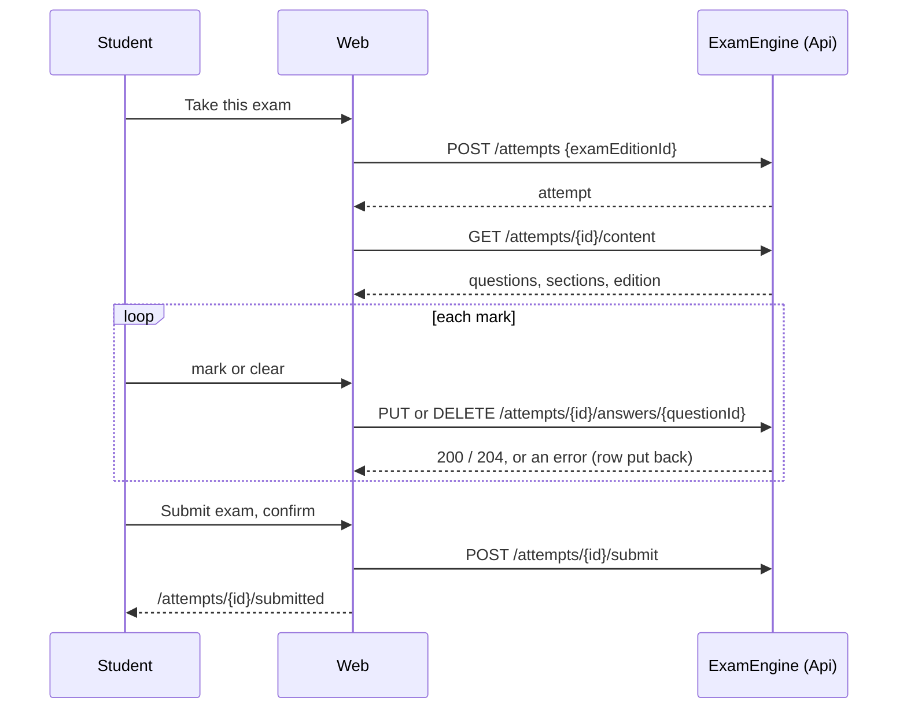

# Taking an exam edition

Technical terms: [glossary](../glossary.md)

## Trigger
A signed-in `Student` (permission `attempts.take`) uses "Take this exam" on a published edition of `/catalog/exams/{id}` (`EditionTakeButton` in `CatalogExam.razor`). The action is absent, not disabled, for anyone without `attempts.take`.

## Steps
1. The start calls `POST /api/v1/exam-engine/attempts` ([Starting, answering and submitting an exam attempt](exam-attempt.md), step 1): a new attempt, or the one in progress on that edition. The page navigates to `/attempts/{id}`; a refused start shows an alert at the top of the Editions card.
2. `/attempts/{id}` (`TakeAttempt.razor`, layout `ExamSessionLayout`: no menu, no breadcrumb) reads `GET .../attempts/{id}/content` with the user's token. A submitted attempt navigates to `/attempts/{id}/submitted`; an attempt that is not the user's, or unknown, renders `NotFoundContent`.
3. It opens on the first question, or on a resumed attempt the first blank one. The question card shows the section line, "Question N" (`h2`, focused after each move), the base text, the statement and the answer area of its type (`AppAnswerOptions`: single choice, true/false or multiple answer); any other type shows a notice and stays blank.
4. A mark saves at once (`PUT .../answers/{questionId}`), a click on the marked option of a single choice or true/false, or unticking the last box, clears it (`DELETE`). The row shows the click at once; the answer sheet changes only when the save succeeded; a failed save puts the row back and says so; a 409 opens the submitted page. `AppSaveStatus` speaks "Saving…", "Answer saved", "Answer cleared".
5. Previous and Next, and every cell of the answer sheet (`AppAnswerSheet`: a side panel from 960 px, a drawer below), move across the sections in paper order.
6. "Submit exam" asks in `AppConfirmDialog` with the blank count and numbers; on confirm `POST .../submit` and the page navigates to `/attempts/{id}/submitted`.
7. `/attempts/{id}/submitted` (`AttemptSubmitted.razor`, `MainLayout`) reads the same content route and shows the edition, the submission date and time in the user's time zone, the answered and blank counts and a link back to the edition. An attempt still in progress opens the simulator.
8. Pictures in the text load from the Web route `/attempts/{id}/images/{imageId}`, which streams the Api's answer with the user's token.



## Rules
- Only the owner opens the simulator, the submitted page, the content and the pictures; an `Admin` gets the not-found page too.
- Sections are the notice subjects of the questions, ordered by their lowest paper number; the questions with none form a last section "Other". An annulled question is not in the attempt, so the numbering jumps.
- No answer key, explanation or rubric reaches the Web.
- Leaving loses nothing: answers are saved; "Leave and continue later" goes to `/catalog/exams/{examId}`, and starting again opens the same attempt.

## Wireframe
```text
+------------------------------------------------------------+
| Guarda Municipal de Manaus 2026 · Consulplan     [new]     |
| Language and literature (questions 1-15)        [Sheet]    |
+------------------------------------------------------------+
| Question 3 of 59                                           |
| +--------------------------------------------------------+ |
| | Base text (when the question has one)                  | |
| +--------------------------------------------------------+ |
| Statement, with images inline                              |
|  ( ) A  option text                                        |
|  (o) B  option text                                        |
|  ( ) C  option text                                        |
|  ( ) D  option text                                        |
|                                                            |
| [< Previous]                              [Next >]         |
|                                    [Submit exam]           |
+------------------------------------------------------------+
| Answer sheet (side panel; a drawer on a phone)   [new]     |
| Language and literature                                    |
|  [1✓] [2✓] [3 ] [4 ] ...                                   |
| Legislation                                                |
|  ... [46✓] [48 ] ...                                       |
| Other                                                      |
|  12 of 59 answered                                         |
+------------------------------------------------------------+
```

```text
+------------------------------------------+
| Submit the exam?                 [new]   |
| 3 questions are blank: 12, 30, 58.       |
| After submitting you cannot change it.   |
|             [Keep answering] [Submit]    |
+------------------------------------------+

+------------------------------------------+
| Exam submitted                   [new]   |
| Guarda Municipal de Manaus 2026          |
| Submitted on 27/10/2026 at 15:42         |
| Answered: 56 · Blank: 3                  |
| [Back to the edition]                    |
+------------------------------------------+
```
Mockup: ../features/mockups/F-169-take-exam-edition.html

## Errors
- `exam_attempt.not_found` — the simulator and the submitted page show the not-found page.
- `exam_attempt.edition_not_found`, `exam_attempt.edition_without_questions` — the start shows its text in the Editions card.
- `exam_attempt.already_submitted` — a save opens the submitted page.
- Any other failure of a save or a submit — an alert in the question card; the submit's has "Try again".
