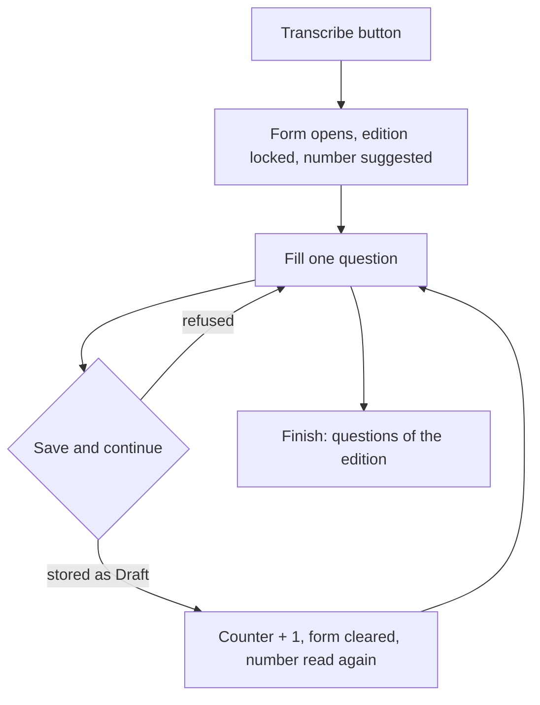

# Transcribe the paper of an edition

Technical terms: [glossary](../glossary.md)

## Trigger
A curator holding `questions.manage` chooses "Transcribe" on a saved edition's Questions card. The button opens `/admin/questions/transcribe?examEditionId={id}`.

## Steps
1. The page is the question form (`QuestionForm.razor`) on its third route; the route is what turns transcription mode on.
2. It reads the edition (`GET /api/v1/question-bank/editions/{id}`), its notice subjects and the suggested number (`GET .../editions/{id}/next-paper-number`).
3. The edition field is locked. The curator fills one question and chooses "Save and continue".
4. The form sends the regular `POST /api/v1/question-bank/questions`: the question is stored as a `Draft`, exactly as the plain form stores it.
5. On success the batch counter goes up by one, the form clears every field except the edition, the notice subject, the content language and the base text (F-102, [Share a base text between questions](shared-base-text.md)), and the paper number is read again from the Api. The kept base text does not count as an unsaved change, and a content language it does not have clears it with a message.
6. "Finish" leaves the screen for the questions list filtered by the edition. Every saved question stays.



## Rules
- The edition cannot change inside a session: to transcribe another one, finish and open it from its own page.
- The suggested number is the highest live paper number of the edition plus one, or 1 when it has none. It is a convenience: a repeated number is still refused by the F-96 uniqueness check (`question.paper_number_taken`), and a refused save keeps what was typed.
- No batch is stored on the server. The counter exists only in the browser, so reopening transcription mode restarts it at 1 over what is already stored.
- Only `SingleChoice` and `TrueFalse` are offered, as in the form.
- The publication card of the form is not drawn in this mode: nothing here publishes.

## Wireframe
```text
+------------------------------------------------------+
| CEBRASPE . Tribunal XY . 2024                  [new] |
| Question 3 of this session           [ Finish ] [new] |
+------------------------------------------------------+
| (i) Question saved. Keep going.                 [new]|
+------------------------------------------------------+
| Classification                                        |
| [ Subject ______ ] [ Topic ______ ] [ Difficulty __ ] |
+------------------------------------------------------+
| Origin                                                |
| Edition: CEBRASPE . Tribunal XY . 2024 (locked) [new] |
| [ Paper number: 4 ] [ Notice subject ______ ]    [new]|
+------------------------------------------------------+
| Statement                                             |
| [______________________________________________]     |
| Type: ( ) Single choice  ( ) True/False               |
+------------------------------------------------------+
| Options / Answer key                                  |
| [______________________________________________]     |
|                                  [ Save and continue ] |
+------------------------------------------------------+
```

## Errors
- `question.exam_edition_not_found` — the edition is unknown or deleted: the screen shows the not-found state and "Finish" is the only action; the number route answers 404.
- `question.paper_number_taken` — the number is already used in the edition (409, F-96): the number field is marked and nothing is cleared.
