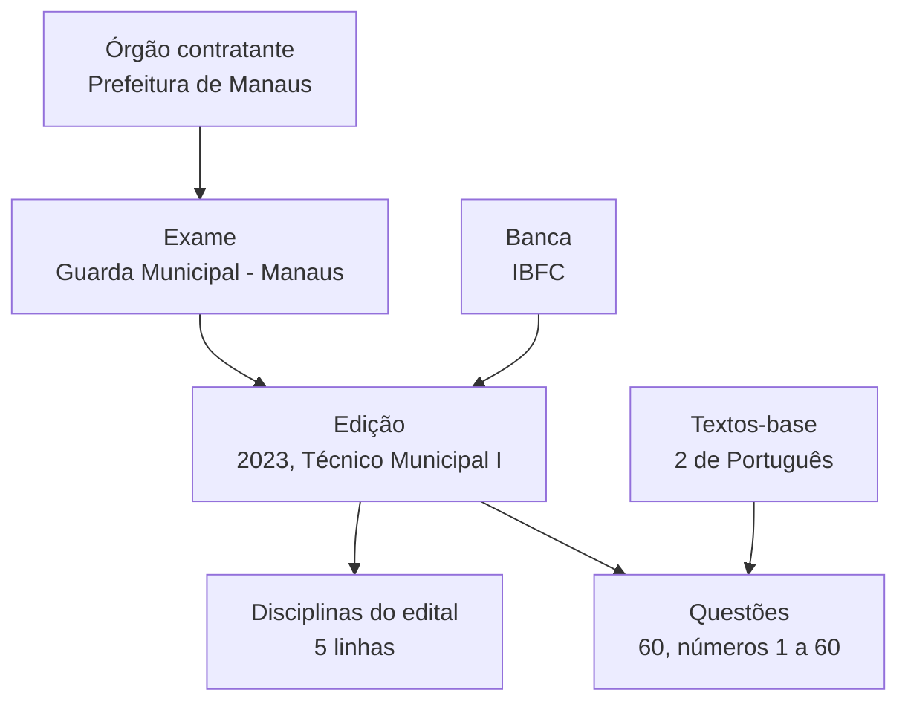

# <span style="color:#3A78C2">Cadastrar no Simulab a prova da Guarda Municipal de Manaus (IBFC, edital 01/2023): banca, órgão, questões e gabarito</span>

Premissas adotadas (conforme as suas respostas): `--md --html`; "órgão" é o órgão contratante (Prefeitura de Manaus) e a banca (IBFC) entra junto; gabarito oficial é o **pós-recurso**, e o preliminar serve de apoio; cadastro pela **tela do back-office**, sem tocar em código. Conferido contra o manual `docs/manual/pt-BR/` e contra as migrações de carga do módulo Catalog. **Não rodei o app**: os passos seguem o manual e precisam ser validados na tela (Seção 8).

---

## <span style="color:#3A78C2">▶ INICIO · 0. Ficha do tutorial</span>

**Título:** Cadastrar no Simulab a prova do concurso de Técnico Municipal I – Guarda Municipal da Prefeitura de Manaus (IBFC, Edital nº 01/2023): banca, órgão contratante, exame, edição, disciplinas do edital, 60 questões e gabarito pós-recurso.

**Objetivo:** ao final, você será capaz de deixar no Simulab uma edição completa dessa prova: a banca IBFC cadastrada, a edição ligada ao exame "Guarda Municipal – Manaus", as 60 questões transcritas com o gabarito oficial, as 3 questões anuladas registradas como anuladas e a edição publicada para os alunos.

**Motivação e aplicabilidade**

- Problema real: o Simulab só treina o aluno com prova de verdade se a prova estiver no banco, com a fonte certa (banca, exame, ano, número) e o gabarito que a banca realmente adotou depois dos recursos.
- Cenário 1: um concurso novo sai e você precisa colocar a prova anterior da mesma banca no ar antes de os alunos começarem a estudar.
- Cenário 2: a banca divulga o gabarito definitivo e ele difere do preliminar; você precisa registrar a anulação sem apagar o histórico.
- Cenário 3: você quer alimentar o banco com uma prova inteira sem reabrir o formulário 60 vezes.
- Quando NÃO usar este caminho: para dezenas de provas de uma vez. A tela serve para uma prova; em lote, o caminho previsto é a importação por IA do épico E-9 (confira se já foi entregue; ver Seção 8).
- No dia a dia: é o trabalho típico do Curador e do Administrador do catálogo.

**Público-alvo:** quem tem uma conta de Administrador do Simulab (permissão "Gerenciar o catálogo" e "Gerenciar o banco de questões"), sabe abrir um PDF e digitar texto, e nunca cadastrou uma prova do zero.

**Tempo estimado (leitura + prática)**

| Nível | Seção | Tempo |
|---|---|---|
| Inicial | 4 e 5 | cerca de 40 min |
| Intermediário | 6 | cerca de 1h30 |
| Avançado | 7 | cerca de 3h (60 questões) |

**Stack e ferramentas:** Simulab rodando local pelo app host (`dotnet run --project src/Hosts/Simulab.AppHost`) ou em outro ambiente; navegador; conta Administrador; os 4 PDFs da pasta `simulae/docs/provas/guarda municipal/manaus/2024, ibfc/` (a prova, os dois gabaritos e o edital).

## <span style="color:#3A78C2">■ FIM DA SECAO 0 — proxima: Secao 1, Pre-requisitos</span>
---

---

## <span style="color:#3A78C2">▶ INICIO · 1. Pre-requisitos</span>

1. **Conta com papel Administrador.** As telas de Bancas, Exames e Edições exigem "Gerenciar o catálogo"; as de Questões e Textos-base exigem "Gerenciar o banco de questões". O Administrador tem as duas; o Curador só a segunda. Como adquirir: peça a um administrador ou veja a página `roles.md` do manual. Tutorial próprio: não.
2. **Simulab no ar e você logado.** Todo o roteiro é feito na interface. Como adquirir: `docs/manual/pt-BR/sign-in-and-sign-out.md`. Tutorial próprio: não.
3. **Ler um caderno de prova e um gabarito.** Você vai cruzar o número da questão com a letra do gabarito. Como adquirir: os PDFs desta pasta bastam. Tutorial próprio: não.
4. **Noção de concurso público (edital, banca, cargo, recurso, anulação).** O vocabulário do Simulab segue o mundo real; a Seção 2 explica cada termo. Tutorial próprio: sim, se você nunca viu um edital (Seção 8).
5. **Digitar com cuidado em português.** Cada questão é copiada à mão: erro de digitação vira erro para o aluno. Tutorial próprio: não.

<span style="color:#3A78C2">**DICA:** abra o PDF da prova e o app lado a lado (duas janelas). Você vai alternar entre eles centenas de vezes.</span>

## <span style="color:#3A78C2">■ FIM DA SECAO 1 — proxima: Secao 2, Glossario</span>
---

---

## <span style="color:#3A78C2">▶ INICIO · 2. Glossario e siglas</span>

| Termo/Sigla | Significado por extenso | Definição em linguagem simples |
|---|---|---|
| Abrange | Disciplinas e tópicos que o título do edital cobre | Liga uma disciplina do edital à lista comum do Simulab (opcional). |
| Anular questão | Registrar anulação | Marcar uma questão publicada como anulada pela banca, com motivo; ela sai da prática e o histórico fica. |
| Banca | Organizadora (`Organizer`) | Quem elabora, aplica e corrige a prova. Aqui: IBFC. |
| Cargo | Posto de trabalho | O emprego para o qual a prova seleciona; texto livre na edição. |
| Disciplina do edital | `NoticeSubject` | A matéria como o edital a nomeia, com o grupo e o número de questões. |
| Edição | `ExamEdition` | Uma prova realmente aplicada: ano do edital, cargo, banca e situação. |
| Edital | Aviso (`Notice`) | O documento oficial que abre o concurso. |
| Enunciado | `Statement` | O texto da questão que diz o que o aluno deve responder. |
| Exame | `Exam` | O concurso que se repete ao longo dos anos; pertence a um órgão contratante. |
| Gabarito | Chave de respostas (`AnswerKey`) | As respostas corretas oficiais; podem mudar depois dos recursos. |
| Gabarito pós-recurso | Gabarito definitivo | O gabarito depois que a banca julgou os recursos; vale como oficial. |
| Gabarito preliminar | Gabarito provisório | O primeiro gabarito, antes dos recursos. |
| IBFC | Instituto Brasileiro de Formação e Capacitação | A banca desta prova. |
| Órgão contratante | `IssuingAuthority` | Quem publica o edital e define as regras: aqui, a Prefeitura de Manaus. |
| Questão anulada | `AnnulledQuestion` | Questão cancelada pela banca; no gabarito vem como `*`. |
| Rascunho / Publicada | `Draft` / `Published` | Se alunos veem ou não a edição ou a questão. |
| SEMAD | Secretaria Municipal de Administração, Planejamento e Gestão | Quem assina o edital pela Prefeitura de Manaus. |
| Texto-base | `BaseText` | Trecho compartilhado por várias questões (a Língua Portuguesa tem dois). |
| Tópico | `Topic` | Segundo nível da lista comum de assuntos, dentro de uma disciplina. |
| Transcrever | Modo de digitação em série | Tela que salva uma questão e já abre a próxima com a edição fixa e o número seguinte. |

## <span style="color:#3A78C2">■ FIM DA SECAO 2 — proxima: Secao 3, Indice remissivo</span>
---

---

## <span style="color:#3A78C2">▶ INICIO · 3. Indice remissivo</span>

- Abrange — Secao 6.1
- Anular questão — Secao 7.4
- Banca (IBFC) — Secao 4.1, 5.1
- Cargo — Secao 5.4
- Disciplina do edital — Secao 6.1
- Edição — Secao 4.1, 5.4
- Enunciado — Secao 6.3
- Exame — Secao 4.2, 5.3
- Gabarito pós-recurso — Secao 4.3, 7.2
- Gabarito preliminar — Secao 4.3, 7.4
- Órgão contratante — Secao 4.1, 4.2, 5.2
- PDF do edital — Secao 5.5
- Publicar a edição — Secao 7.6
- Questão anulada — Secao 4.3, 7.4
- Texto-base — Secao 6.2
- Tópico — Secao 7.1
- Transcrever — Secao 6.3, 7.1
- Troca de gabarito — Secao 7.5

## <span style="color:#3A78C2">■ FIM DA SECAO 3 — proxima: Secao 4, Introducao</span>
---

---

## <span style="color:#3A78C2">▶ INICIO · 4. Introducao e conceitos fundamentais</span>

### <span style="color:#3A78C2">4.1 O mapa das peças</span>

Pense numa obra. O **órgão contratante** é o dono do terreno que decide o que construir (a Prefeitura de Manaus abre o concurso). A **banca** é a empreiteira que executa e confere o trabalho (o IBFC elabora, aplica e corrige a prova). O **exame** é o projeto que se repete (a Guarda Municipal de Manaus). A **edição** é uma obra entregue num ano (o Edital nº 01/2023, cargo Técnico Municipal I – Guarda Municipal). As **questões** são os cômodos dessa obra. *Onde a analogia falha:* a empreiteira pode mudar de uma obra para a outra; por isso a banca fica na edição, nunca no exame.

**Figura 4.1 — A hierarquia que você vai preencher, de cima para baixo**



Regra que decide a ordem do trabalho: cada peça precisa existir antes de quem aponta para ela. Banca e exame antes da edição; edição antes das disciplinas do edital e das questões; textos-base antes das questões que os usam.

### <span style="color:#3A78C2">4.2 O que o Simulab já tem (conferido nas migrações)</span>

A carga inicial do módulo Catalog (`20260929142114_SeedMunicipalGuardCatalog`) já cadastra o órgão **Prefeitura de Manaus** e o exame **Guarda Municipal** (município Manaus, Concurso público, pt-BR). Já existe também uma edição **2026**, de outro edital (Edital nº 01 de 23 de março de 2026), com outra banca. Ela não conflita com a sua: o Simulab proíbe duas edições com o mesmo ano, cargo e banca no mesmo exame, e a sua é de 2023.

Conclusão prática: **o órgão e o exame você só confere**; a **banca IBFC não existe** na carga (as sete bancas são AOCP, Consulplan, FGV, Copeve/Ufal, Vunesp, FCC e Cebraspe) e precisa ser cadastrada; a edição 2023, as disciplinas, os textos-base e as 60 questões são novos.

<span style="color:#C2504A">**ATENCAO:** isso vale para o código atual desta branch. Se o seu ambiente é antigo ou foi limpo à mão, confira na tela (Seção 5.2) antes de supor que o órgão existe.</span>

### <span style="color:#3A78C2">4.3 O que os PDFs dizem (e o que importa deles)</span>

- **Prova (`guarda_municipal.pdf`)**: caderno IBFC_01, 60 questões objetivas de 5 alternativas, mais uma redação. Língua Portuguesa 10, Noções de Informática 5, Geografia e História de Manaus 5, Noções de Direito 25, Legislação 15. A redação não é questão objetiva e **fica fora** do cadastro.
- **Edital (`Edital de abertura 01-2023.pdf`)**: "Edital nº 01, de 27 de novembro de 2023", Prefeitura de Manaus / SEMAD, execução do IBFC, cargo Técnico Municipal I – Guarda Municipal (SEMSEG). A tabela 9.1.1 do edital confirma os grupos: Conhecimentos Gerais (Português, Informática, Geografia e História de Manaus) e Conhecimentos Específicos (Noções de Direito, Legislação).
- **Gabaritos**: o preliminar e o pós-recurso são iguais em 57 das 60 questões. Diferem nas **três anuladas** (marcadas `*` no pós-recurso): questão 32 (preliminar A), 43 (preliminar D) e 54 (preliminar E).

Por que isso importa: o Simulab só deixa **anular uma questão publicada**, e uma questão só é publicada se tiver **exatamente uma alternativa correta**. Então as três anuladas entram com a letra do gabarito preliminar, são publicadas e depois anuladas (Seção 7.4). É para isso que o preliminar serve.

<span style="color:#3A78C2">**DICA:** a data de aplicação da prova não aparece com clareza no texto extraído do edital (o cronograma é uma tabela quebrada). O campo é opcional; deixe vazio em vez de chutar. A carga do próprio Simulab faz o mesmo para as outras edições.</span>

### <span style="color:#3A78C2">4.4 Decisões deste tutorial</span>

| Decisão | Escolha | Motivo |
|---|---|---|
| Ano do edital | 2023 | O edital é de 27/11/2023; a pasta diz 2024 porque a prova foi aplicada em 2024. O campo do Simulab é o ano **do edital**. |
| Gabarito oficial | Pós-recurso | É o definitivo. |
| Redação | Fora | Não é questão objetiva; o Simulab corrige questões de escolha. |
| Tópicos | A lista da Tabela 7.1 | Sugestão minha, a partir dos 71 tópicos da carga; você pode trocar um a um. |
| Edição | Rascunho até o fim | Só publique quando as 60 estiverem conferidas (Seção 7.6). |

## <span style="color:#3A78C2">■ FIM DA SECAO 4 — proxima: Secao 5, Iniciante</span>
---

---

## <span style="color:#3A78C2">▶ INICIO · 5. Projeto pratico — iniciante</span>

**Resultado desta seção:** a banca IBFC existe, o órgão e o exame foram conferidos e a edição 2023 existe em **Rascunho**, com o PDF do edital guardado.

### <span style="color:#3A78C2">5.1 Cadastrar a banca IBFC</span>

1. No menu lateral, seção **Conteúdo**, escolha **Bancas**. Digite `IBFC` na busca: deve vir vazio. Se vier, **não cadastre outra** (o nome e a sigla são únicos, mesmo entre excluídas); use a que existe.
2. Escolha **Adicionar**.
3. **Nome:** `Instituto Brasileiro de Formação e Capacitação`.
4. **Sigla:** `IBFC` (é salva em maiúsculas).
5. **Tipo:** banca examinadora.
6. **Site oficial:** `https://www.ibfc.org.br` (o endereço consta do edital) e **Descrição:** opcional; deixe vazia.
7. Escolha **Salvar**.

**Código 5.1 — Os dados da banca, prontos para copiar**

```text
Nome:  Instituto Brasileiro de Formação e Capacitação
Sigla: IBFC
Tipo:  Banca examinadora
Site:  https://www.ibfc.org.br
```

Por que esses valores: o nome é "como a banca assina seus editais" (o edital diz exatamente isso) e a sigla é o nome curto que aparece na **linha de fonte** das questões: `IBFC · Guarda Municipal · 2023`.

<span style="color:#C2504A">**ARMADILHA:** "Outra banca já tem esse nome" ou "essa sigla" significa que existe uma, talvez excluída. Excluída ainda ocupa o nome. Não invente `IBFC2`: peça para um administrador restaurá-la ou use outro nome oficial.</span>

<span style="color:#3A78C2">**RESULTADO TESTAVEL:** a lista de Bancas mostra "Instituto Brasileiro de Formação e Capacitação · IBFC · Banca examinadora".</span>

### <span style="color:#3A78C2">5.2 Conferir o órgão contratante</span>

1. Em **Conteúdo**, escolha **Órgãos contratantes** e digite `manaus` na busca.
2. Deve aparecer **Prefeitura de Manaus**. Está pronto: não cadastre outro (a carga garante um por cidade).
3. Se **não** aparecer, cadastre: **Adicionar**, nome `Prefeitura de Manaus` (o nome com que ela assina o edital), site e descrição opcionais, **Salvar**.

<span style="color:#3A78C2">**DICA:** o órgão contratante **não** é a banca. O edital é da Prefeitura/SEMAD; o IBFC só executa. Cadastrar "IBFC" como órgão é o erro mais comum de quem começa.</span>

### <span style="color:#3A78C2">5.3 Conferir o exame</span>

1. Em **Exames**, busque `guarda manaus` (palavras em qualquer ordem).
2. Deve aparecer **Guarda Municipal**, órgão Prefeitura de Manaus, Concurso público, Municipal. Escolha **Editar**: você vai estar na página do exame, com o cartão **Edições** embaixo.
3. Se não existir: **Adicionar**, órgão Prefeitura de Manaus, nome `Guarda Municipal`, tipo Concurso público, abrangência Municipal, município `Manaus`, idioma Português (Brasil), **Salvar**.

### <span style="color:#3A78C2">5.4 Criar a edição 2023</span>

1. Na página do exame, no cartão **Edições**, escolha **Adicionar edição**.
2. Preencha como na Tabela 5.1 e escolha **Salvar**. A edição nasce **Rascunho**; deixe assim.

**Tabela 5.1 — Campos da edição**

| Campo | Valor | De onde vem |
|---|---|---|
| Banca | IBFC | digite duas letras e escolha na lista |
| Ano do edital | 2023 | "Edital nº 01, de 27 de novembro de 2023" |
| Cargo | `Técnico Municipal I - Guarda Municipal` | capa da prova e item 1.2 do edital |
| Identificação do edital | `Edital nº 01, de 27 de novembro de 2023` | cabeçalho do edital |
| Link do edital | vazio | não há link oficial estável no PDF; use o PDF (Seção 5.5) |
| Data de aplicação | vazia | não confirmada (Seção 4.3) |
| Situação | Rascunho | só publica no fim |

<span style="color:#C2504A">**ARMADILHA:** o cargo da edição 2026 tem o **mesmo texto**. Não há conflito porque o **ano** muda (2023 × 2026). Mas "ano, cargo e banca" juntos são únicos: se errar o ano e salvar 2026 com a banca certa, a mensagem "Este exame já tem uma edição com este ano, cargo e banca" aparece.</span>

### <span style="color:#3A78C2">5.5 Guardar o PDF do edital</span>

1. Ainda na edição, no cartão **Edital e aplicação**, escolha **Escolher PDF** e selecione `Edital de abertura 01-2023.pdf` (0,66 MB, abaixo do limite de 20 MB).
2. Escolha **Salvar**: o arquivo vai junto. A edição passa a mostrar nome e tamanho, e **Baixar** funciona.

Por que guardar: o site do IBFC pode mudar ou sair do ar; a cópia fica com o Simulab. Os alunos só baixam o PDF de edições publicadas.

<span style="color:#C2504A">**ATENCAO:** o PDF só é enviado quando você aperta **Salvar**. Se escolher o arquivo e apertar **Cancelar**, nada é enviado.</span>

### <span style="color:#3A78C2">5.6 Exercícios e resultado testável</span>

<span style="color:#3A78C2">**RESULTADO TESTAVEL:** no cartão **Edições** do exame "Guarda Municipal – Manaus" aparecem duas linhas: 2026 (Publicada, outra banca) e **2023 · Técnico Municipal I - Guarda Municipal · IBFC · Rascunho**.</span>

**Exercício 5.1.** Tente salvar outra edição com os mesmos dados. *Esperado:* a mensagem de duplicidade; nada é criado.

**Exercício 5.2.** Tente cadastrar uma banca "ibfc" (minúsculas). *Esperado:* "Outra banca já tem essa sigla".

**O que ficou:** a regra "peça que aponta precisa existir antes" e o fato de que o órgão e o exame são reaproveitados. A Seção 6 parte da edição que você acabou de criar.

## <span style="color:#3A78C2">■ FIM DA SECAO 5 — proxima: Secao 6, Intermediario</span>
---

---

## <span style="color:#3A78C2">▶ INICIO · 6. Projeto pratico — intermediario</span>

Partindo da edição criada na Seção 5 (Tabela 5.1), vamos agora preencher o que o edital descreve (disciplinas), preparar o material compartilhado (textos-base) e transcrever o primeiro bloco da prova.

**Resultado desta seção:** a edição tem 5 disciplinas do edital, 2 textos-base e as questões 1 a 10 (Língua Portuguesa) salvas como rascunho.

### <span style="color:#3A78C2">6.1 Disciplinas do edital</span>

Abra a edição 2023 e role até o cartão **Disciplinas do edital**. Para cada linha da Tabela 6.1, escolha **Adicionar disciplina do edital**, preencha e **Salvar**. O botão Salvar da edição nunca salva estas linhas: cada uma tem o seu diálogo.

**Tabela 6.1 — Disciplinas do edital (item 9.1.1 do edital)**

| Grupo | Disciplina | Nº de questões | Abrange (opcional) |
|---|---|---|---|
| Conhecimentos Gerais | Língua Portuguesa | 10 | Leitura e Interpretação, Produção Textual, Morfologia, Sintaxe, Ortografia e Pontuação (disciplinas inteiras) |
| Conhecimentos Gerais | Noções de Informática | 5 | Informática (inteira) |
| Conhecimentos Gerais | Geografia e História de Manaus | 5 | Conhecimentos locais › Manaus (AM) |
| Conhecimentos Específicos | Noções de Direito | 25 | Direito Administrativo, Direito Constitucional, Direito Penal, Direitos Humanos (inteiras) |
| Conhecimentos Específicos | Legislação | 15 | Legislação Municipal, Legislação Federal, Estatuto das Guardas Municipais, Estatuto do Desarmamento (inteiras) |

Soma: 10 + 5 + 5 + 25 + 15 = **60**, e o rodapé do cartão deve mostrar 60.

<span style="color:#3A78C2">**DICA:** o grupo sugere o que você já usou ao digitar (sem diferenciar acento e maiúscula); ao adicionar várias seguidas, o grupo da última já vem preenchido. O **Abrange** é opcional: se tiver dúvida, deixe em branco ("Não mapeada" não impede salvar nem publicar).</span>

<span style="color:#C2504A">**ARMADILHA:** o grupo é texto livre. "Conhecimentos Gerais" e "Conhecimentos gerais" viram o mesmo grupo (maiúscula e acento não contam), mas "Conhec. Gerais" cria um terceiro. Copie exatamente o do edital.</span>

### <span style="color:#3A78C2">6.2 Textos-base da Língua Portuguesa</span>

Conferindo o que cada enunciado cita: as questões 1, 2, 3, 5 e 6 se apoiam no **Texto 1**; as questões 4, 8 e 9 se apoiam no **Texto 2** (a 4 aparece antes dele no caderno, mas a frase que ela cita é do Texto 2); as questões 7 e 10 são autossuficientes e **não levam texto-base**. Para cada texto: **Textos-base › Adicionar**.

| Título (só você vê) | Idioma | Texto |
|---|---|---|
| IBFC 2023 Manaus – Texto 1: O que nos mantém vivos? | Português (Brasil) | o trecho de Ricardo Viveiros, copiado do caderno, com a nota "Texto modificado especificamente para este concurso" |
| IBFC 2023 Manaus – Texto 2: O progresso é o que nos mantém vivos | Português (Brasil) | o trecho de Matheus de Souza, com a nota de modificação |

<span style="color:#C2504A">**ATENCAO:** o idioma do texto-base tem de ser igual ao da questão (os dois pt-BR). Só textos do mesmo idioma aparecem na escolha da questão.</span>

### <span style="color:#3A78C2">6.3 Transcrever as questões 1 a 10</span>

1. Abra a edição e, no cartão **Questões**, escolha **Transcrever**. O formulário abre com a edição fixa e o **número 1** sugerido.
2. Preencha a questão conforme o **Código 6.1** (a questão 1 completa, como modelo).
3. Escolha **Salvar e continuar**. A questão vira rascunho, o contador "Questão 2 desta sessão" sobe e o formulário limpa, mantendo edição, disciplina do edital, idioma e texto-base.
4. Repita seguindo a ordem do texto-base: 1, 2 e 3 com o Texto 1; **troque** para o Texto 2 na 4; volte ao Texto 1 na 5 e na 6; **retire** o texto-base na 7; Texto 2 na 8 e na 9; retire de novo na 10 (Redação Oficial). O texto-base escolhido continua entre uma questão e a seguinte, então toda troca é por sua conta.

**Código 6.1 — Questão 1, campos do formulário**

```text
Tipo de questão:        Múltipla escolha
Disciplina / Tópico:    Leitura e Interpretação / Interpretação de textos
Idioma do conteúdo:     Português (Brasil)
Dificuldade:            (vazia)
Texto-base:             IBFC 2023 Manaus – Texto 1
Enunciado:              Analise as afirmativas abaixo e dê valores Verdadeiro (V) ou Falso (F).
                        ( ) O texto 1 tem como único enfoque o nosso comportamento na época do Natal.
                        ( ) Sobre o Brasil, o texto afirma que nosso país está evoluindo com a finalidade de se recuperar de danos já transcorridos.
                        ( ) Paz, meio ambiente, segurança alimentar, cultura, educação e equilíbrio econômico com crescimento sustentável são algumas necessidades para a manutenção de nossa existência.
                        ( ) Há um consenso sobre o que nos mantém vivos: apenas a fé.
                        ( ) Ao escrever 'Política' com letra inicial maiúscula, o autor expõe soberania, independência, liberdade, democracia e direitos humanos como elementos execráveis ao nosso país.
                        Assinale a alternativa que apresenta a sequência correta de cima para baixo.
Alternativas:           A  V - F - F - F - F
                        B  F - V - V - F - F      <- correta (gabarito: B)
                        C  V - V - V - V - F
                        D  V - F - V - F - V
                        E  F - F - V - V - F
Origem:                 Edição IBFC · Guarda Municipal · 2023 (já fixa) · Número 1 · Disciplina do edital: Língua Portuguesa
```

Use listas do editor para as afirmativas, se quiser; só a formatação simples é mantida. O gabarito entra marcando a alternativa correta (Seção 7.2 traz a tabela completa).

<span style="color:#C2504A">**ARMADILHA:** a questão 3 pede a alternativa **incorreta** (resposta E, "Nariz - Narisinho"); as 11, 21, 29, 32, 34, 37, 43, 51, 57 e 59 também, e a 19 pede o "exceto". Confira o verbo do enunciado ("incorreta", "exceto") antes de marcar. Erro de leitura aqui vira gabarito invertido no banco.</span>

<span style="color:#3A78C2">**RESULTADO TESTAVEL:** o cartão **Questões** da edição lista 10 linhas, números 1 a 10, todas Rascunho, disciplina do edital Língua Portuguesa; e a lista de **Questões** (menu) mostra a fonte `IBFC · Guarda Municipal · 2023 · nº N`.</span>

### <span style="color:#3A78C2">6.4 Exercícios</span>

**Exercício 6.1.** Em uma das questões já salvas, troque a alternativa correta e salve. *Esperado:* como é rascunho, salva sem pedir motivo (só questão publicada exige "Motivo da troca de gabarito").

**Exercício 6.2.** Em **Textos-base**, abra o Texto 1: o cartão "Questões que usam este texto" deve listar 5 questões (1, 2, 3, 5 e 6); o Texto 2 lista 3 (4, 8 e 9).

## <span style="color:#3A78C2">■ FIM DA SECAO 6 — proxima: Secao 7, Avancado</span>
---

---

## <span style="color:#3A78C2">▶ INICIO · 7. Projeto pratico — avancado</span>

Partindo do fluxo de transcrição da Seção 6 (Código 6.1), vamos agora terminar a prova, aplicar o gabarito oficial, anular as três questões e publicar.

**Resultado desta seção:** 60 questões publicadas, 57 com a letra do gabarito pós-recurso e 3 anuladas, com a edição publicada.

### <span style="color:#3A78C2">7.1 Transcrever as questões 11 a 60</span>

Continue em **Transcrever** (o número sugerido segue o que já está salvo; o contador "desta sessão" recomeça em 1 se você sair, mas o número não). Troque a **disciplina do edital** sempre que a prova mudar de matéria: Informática 11–15, Geografia e História de Manaus 16–20, Noções de Direito 21–45, Legislação 46–60. Escolha o **tópico** de cada questão pela Tabela 7.1.

**Tabela 7.1 — Gabarito pós-recurso, disciplina e tópico sugerido, por questão**

| Nº | Gab. | Disciplina › Tópico sugerido | Nº | Gab. | Disciplina › Tópico sugerido |
|---|---|---|---|---|---|
| 1 | B | Leitura e Interpretação › Interpretação de textos | 31 | D | Direito Administrativo › Princípios da administração pública |
| 2 | A | Ortografia e Pontuação › Pontuação | 32 | * (prelim. A) | Direito Constitucional › Princípios constitucionais |
| 3 | E | Ortografia e Pontuação › Ortografia | 33 | D | Direito Constitucional › Direitos fundamentais |
| 4 | D | Sintaxe › Sintaxe, Concordância e Regência | 34 | C | Direito Constitucional › Direitos fundamentais |
| 5 | C | Ortografia e Pontuação › Ortografia | 35 | D | Direito Constitucional › Princípios constitucionais |
| 6 | B | Sintaxe › Sintaxe, Concordância e Regência | 36 | C | Direito Constitucional › Princípios constitucionais |
| 7 | A | Ortografia e Pontuação › Ortografia | 37 | E | Direito Constitucional › Direitos fundamentais |
| 8 | B | Sintaxe › Sintaxe, Concordância e Regência | 38 | B | Direito Constitucional › Direitos fundamentais |
| 9 | C | Morfologia › Morfologia | 39 | B | Direito Penal › Crimes específicos |
| 10 | C | Produção Textual › Comunicação escrita | 40 | A | Estatuto do Desarmamento › Lei 10.826/2003 |
| 11 | C | Informática › Sistemas operacionais Windows | 41 | D | Direito Penal › Tipos penais |
| 12 | A | Informática › Conceitos de hardware (rede) | 42 | E | Direito Penal › Crimes específicos |
| 13 | E | Informática › Conceitos de hardware (nuvem) | 43 | * (prelim. D) | Direito Penal › Códigos penais |
| 14 | B | Informática › Segurança na internet | 44 | B | Direito Penal › Tipos penais |
| 15 | B | Informática › Pacotes Microsoft Office | 45 | A | Direito Penal › Processo penal |
| 16 | A | Conhecimentos locais › Manaus (AM) | 46 | D | Legislação Municipal › Estatuto dos Funcionários Públicos Municipais |
| 17 | B | Conhecimentos locais › Manaus (AM) | 47 | B | Legislação Municipal › Estatuto dos Funcionários Públicos Municipais |
| 18 | C | Conhecimentos locais › Manaus (AM) | 48 | C | Legislação Federal › Lei Maria da Penha |
| 19 | D | Conhecimentos locais › Manaus (AM) | 49 | D | Legislação Federal › Lei Maria da Penha |
| 20 | B | Conhecimentos locais › Manaus (AM) | 50 | E | Estatuto das Guardas Municipais › Lei 13.022/2014 |
| 21 | C | Direitos Humanos › Proteção de direitos fundamentais | 51 | A | Estatuto das Guardas Municipais › Lei 13.022/2014 |
| 22 | D | Direitos Humanos › Legislação de direitos humanos | 52 | D | Legislação Municipal › Lei complementar municipal |
| 23 | E | Direitos Humanos › Direitos humanos e cidadania | 53 | A | Legislação Municipal › Lei complementar municipal |
| 24 | A | Direitos Humanos › Legislação de direitos humanos | 54 | * (prelim. E) | Estatuto do Desarmamento › Lei 10.826/2003 |
| 25 | D | Direito Constitucional › Legislação de proteção | 55 | A | Direitos Humanos › Legislação de direitos humanos |
| 26 | B | Direito Administrativo › Legislação administrativa | 56 | A | Legislação Federal › ECA (Lei 8.069/1990) |
| 27 | D | Direito Administrativo › Legislação administrativa | 57 | B | Direito Penal › Crimes específicos |
| 28 | C | Direito Administrativo › Legislação administrativa | 58 | D | Direito Penal › Crimes específicos |
| 29 | D | Direito Administrativo › Conceitos fundamentais | 59 | A | Direito Penal › Crimes específicos |
| 30 | B | Direito Administrativo › Conceitos fundamentais | 60 | E | Direito Administrativo › Legislação administrativa |

Notas de leitura da tabela:

- Os tópicos são **sugestões**: a lista comum não tem "redes", "nuvem" nem "Estatuto da Igualdade Racial"; usei o mais próximo. Se quiser fidelidade, registre esses tópicos em **Disciplinas e tópicos** antes de transcrever (é trabalho de Administrador) e depois escolha-os; isso é uma melhoria de taxonomia, não do cadastro da prova.
- A questão 15 traz uma **planilha** como imagem (A1=12, B1=13, A2=10, B2=11). O editor insere imagem (PNG, JPEG, WebP ou GIF, até 2 MB, com texto alternativo). Duas formas válidas: recortar a tabela do PDF e inserir com texto alternativo "Planilha: A1 12, B1 13, A2 10, B2 11", ou escrever essa descrição no enunciado. Responde-se B: A1 + B2 = 12 + 11 = 23.
- A questão 39 traz, no original, "Lei nº 23.869/2019" (o certo é 13.869/2019). **Transcreva como está impresso**; o aluno vê a prova como foi aplicada. Se quiser registrar, use a explicação.
- A questão 60 e as de V/F com cinco linhas (1, 22, 33, 40, 45, 50, 56) têm enunciado longo: use listas do editor.

<span style="color:#C2504A">**ARMADILHA:** as colunas do PDF da prova saem embaralhadas ao copiar e colar (a prova é diagramada em duas colunas, com alternativas fora de ordem). Digite ou cole bloco a bloco e releia contra o PDF. O número da questão é único por edição; se errar, a mensagem "Número já usado nesta edição" avisa.</span>

### <span style="color:#3A78C2">7.2 Aplicar o gabarito</span>

Para cada questão, marque como **correta** a letra da coluna **Gab.** da Tabela 7.1. Para as três anuladas (32, 43, 54), marque a letra do **preliminar** indicada entre parênteses (Seção 7.4 explica por quê).

**Código 7.1 — O gabarito pós-recurso em uma linha por bloco (confira com o PDF "GABARITO PÓS RECURSO")**

```text
 1- 5:  B A E D C       6-10:  B A B C C
11-15:  C A E B B      16-20:  A B C D B
21-25:  C D E A D      26-30:  B D C D B
31-35:  D * D C D      36-40:  C E B B A
41-45:  D E * B A      46-50:  D B C D E
51-55:  A D A * A      56-60:  A B D A E
```

<span style="color:#3A78C2">**DICA:** depois de salvar 10 questões, abra a lista de Questões, filtre pela edição e compare as letras com este bloco. Corrigir cedo é barato; depois de publicada, trocar o gabarito exige motivo e gera versão nova (Seção 7.5).</span>

### <span style="color:#3A78C2">7.3 Publicar as questões</span>

1. Abra cada rascunho e, no cartão **Publicação**, escolha **Publicar**. Ele só fica disponível se a questão estiver salva e completa: tópico, idioma, enunciado, de 2 a 5 alternativas com texto e **exatamente uma correta**.
2. A questão publicada vira **versão 1**, "Primeira publicação".

Há um caminho com revisão (**Enviar para revisão**, e outra pessoa aprova na [Fila de revisão](../manual/pt-BR/review-queue.md)). Sendo você o Administrador e a prova um material público conferido contra o PDF, a publicação direta é o atalho. Se a política da sua equipe exige dupla conferência, use a revisão.

<span style="color:#C2504A">**ATENCAO:** "Publicar" **não** publica a edição. São dois botões diferentes. Questão publicada numa edição ainda em rascunho continua invisível ao aluno.</span>

### <span style="color:#3A78C2">7.4 Anular as questões 32, 43 e 54</span>

Para cada uma das três, depois de publicada:

1. Abra a questão e olhe o cartão **Publicação**. Se o formulário tiver alterações não salvas, salve antes ("Salve suas alterações primeiro").
2. Escolha **Anular questão**.
3. No **motivo** (até 500 caracteres, obrigatório), cite o ato oficial. Modelo:

**Código 7.2 — Motivo da anulação**

```text
Anulada pela banca IBFC no Gabarito Pós Recurso do Edital nº 01/2023 (Prefeitura de Manaus/SEMAD), cargo Técnico Municipal I - Guarda Municipal. Gabarito preliminar: <A | D | E>.
```

4. Confirme com **Anular**. A questão passa a **Anulada**: aviso amarelo, campos só leitura, linha "Anulada" no Histórico.

Por que isso e não apagar ou deixar sem resposta: a regra do projeto é que uma anulação **nunca reescreve o histórico**; ela cria uma versão. E como o Simulab só aceita publicar com uma correta, a letra preliminar é o jeito honesto de chegar lá. A **data** exibida é a do seu registro, não a oficial: o lugar do ato oficial é o motivo.

<span style="color:#C2504A">**ARMADILHA:** uma questão anulada não pode ser salva, publicada, despublicada nem excluída. Se errou a anulação, use **Reintegrar questão** (com motivo); ela volta a Publicada e vira nova versão. Como uma anulada conta num simulado completo é regra de pontuação da edição, que não é definida aqui.</span>

### <span style="color:#3A78C2">7.5 Se o gabarito mudar depois (troca de gabarito)</span>

Cenário hipotético: o IBFC corrige a questão 17 depois. Em uma questão **publicada**, marque outra alternativa como correta: aparece **Motivo da troca de gabarito** (obrigatório, até 500 caracteres). **Salvar** registra a versão como "Gabarito alterado", com motivo e data. Quem fez a prova com a versão anterior continua corrigido por ela.

### <span style="color:#3A78C2">7.6 Conferir e publicar a edição</span>

Antes de apertar **Publicada**:

1. Em **Questões**, filtre **Edição** = esta e **Situação** = Publicada ou Anulada: devem ser 60 no total, 57 publicadas e 3 anuladas.
2. Confira que os números 1 a 60 existem uma vez cada e que cada disciplina do edital tem o número de questões da Tabela 6.1 (use o cartão **Questões** da edição).
3. Abra três questões ao acaso e use **Visualizar como aluno** + **Mostrar resposta** para comparar com o PDF.
4. Na edição, em **Publicação**, escolha **Publicada** e **Salvar**.

<span style="color:#3A78C2">**RESULTADO TESTAVEL:** em **Catálogo** (visão do aluno), o exame "Guarda Municipal – Manaus" mostra a edição 2023 do IBFC com o botão de baixar o edital, e a prática enxerga as 57 questões não anuladas.</span>

### <span style="color:#3A78C2">7.7 Erros, segurança e observabilidade</span>

- **Erros:** o app usa mensagens por campo e um aviso no topo com os campos que faltam (clicar leva ao campo). A tabela de mensagens de cada página está no manual (`questions.md`, `exam-editions.md`, `organizers.md`).
- **Concorrência:** se outra pessoa mexer na mesma questão, o app pede para recarregar ("Esta questão já está publicada", "Outra gravação alterou o histórico...").
- **Permissões:** o Curador transcreve e publica questões, mas **não** cadastra banca nem edição (isso é "Gerenciar o catálogo"). Teste o fluxo com o menor papel que o usa, não só com o Administrador.
- **Conteúdo:** só formatação simples é mantida; scripts e links que não são `http`/`https` são removidos ao salvar. Prova pública, sem dado pessoal.
- **Direito autoral:** a prova e o texto-base vêm de fontes públicas (concurso, Folha de S.Paulo, blog). Mantenha as notas "Texto modificado especificamente para este concurso" e a fonte no texto-base.
- **Rastreabilidade:** cada questão carrega a linha de fonte `IBFC · Guarda Municipal · 2023`, o número na prova, as versões e o motivo de cada anulação ou troca de gabarito.

### <span style="color:#3A78C2">7.8 Desafio final</span>

Faça uma **conferência cruzada** do que você cadastrou: exporte (ou copie) da lista de Questões filtrada pela edição a letra correta de cada uma e compare, linha a linha, com o Código 7.1. *Esperado:* 57 letras iguais e 3 anuladas (32, 43, 54), com os motivos do Código 7.2. Qualquer divergência: abra a questão, confira o PDF e, se publicada, corrija com motivo (Seção 7.5).

## <span style="color:#3A78C2">■ FIM DA SECAO 7 — proxima: Secao 8, Resumo</span>
---

---

## <span style="color:#3A78C2">▶ INICIO · 8. Resumo, pre-requisitos pendentes e proximos passos</span>

**Resumo.** Nível inicial: banca IBFC criada, órgão e exame conferidos, edição 2023 em rascunho com o PDF do edital. Nível intermediário: 5 disciplinas do edital (60 questões no total), 2 textos-base e as questões 1 a 10. Nível avançado: questões 11 a 60, gabarito pós-recurso aplicado, 57 publicadas e 3 anuladas (32, 43, 54), edição publicada.

**O que não verifiquei:** não rodei o app; os passos vêm do manual e do código de carga, e a ordem dos botões pode ter pequenas diferenças na tela. Os tópicos da Tabela 7.1 são minha sugestão. A data de aplicação não foi confirmada. A leitura dos PDFs foi conferida contra a imagem do gabarito; o texto da prova foi extraído por ferramenta e precisa ser relido ao digitar.

**Pré-requisitos ainda não cobertos por tutorial:**

1. Noção de concurso público (edital, banca, recurso, anulação) — Seção 1, item 4.
2. Papéis e permissões do Simulab (por que o Curador não vê Bancas) — Seção 1, item 1.

**Para onde evoluir:** (a) cadastrar a mesma banca em outro concurso e copiar disciplinas de outra edição ("Copiar de outra edição"); (b) quando a importação por IA do épico E-9 estiver disponível, trocar a transcrição manual por rascunhos revisados; (c) registrar na taxonomia os tópicos que faltaram (redes, nuvem, Estatuto da Igualdade Racial).

**Deseja que eu crie um tutorial dedicado para algum destes pré-requisitos antes de prosseguir para outro assunto?** As opções encontradas: (1) "Como ler um edital de concurso"; (2) "Papéis e permissões do Simulab".

## <span style="color:#3A78C2">■ FIM DA SECAO 8 — fim do tutorial</span>
---
