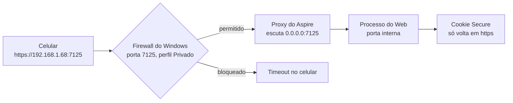
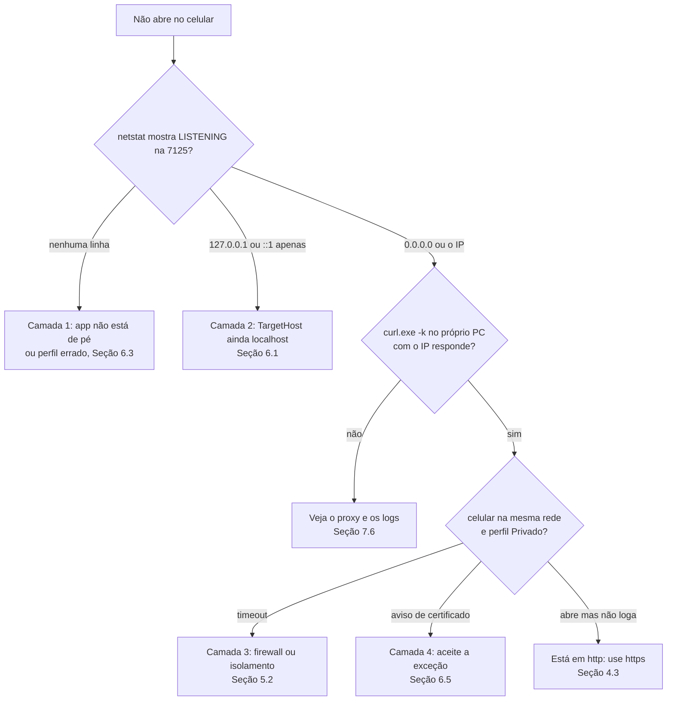

# <span style="color:#3A78C2">Expor um app Blazor + Aspire AppHost na rede local (Windows): TargetHost 0.0.0.0, perfil https-lan, firewall, certificado e cookie Secure</span>

Premissas adotadas: `--md --html`; idioma pt-BR; Windows 11, PowerShell 7, .NET 10, Aspire 13.6.2 e Visual Studio; o exemplo é o próprio Simulab (portas 7125 https e 5211 http no Web). Os fatos do Simulab foram conferidos nos commits `2651449` e `b797e0a`, em `docs/infra.md` (verificado em 2026-10-22) e em `Program.cs`. **Não montei um laboratório do zero para este texto**: os trechos genéricos (Código 5.1) seguem o mesmo padrão do código real e precisam ser rodados por você (Seção 5.5).

---

## <span style="color:#3A78C2">▶ INICIO · 0. Ficha do tutorial</span>

**Título:** Expor um app Blazor Interactive Server, iniciado por um Aspire AppHost, para outros dispositivos da mesma rede (Wi-Fi/LAN), no Windows.

**Objetivo:** ao final, você será capaz de abrir `https://<IP-da-sua-máquina>:7125` no celular ou em outro computador da mesma rede, entrar com login e senha, e, quando não abrir, dizer em menos de cinco minutos em qual das quatro camadas (processo, `TargetHost`, firewall, certificado/cookie) está o problema, lendo a saída do `netstat`.

**Motivação e aplicabilidade**

- Problema real: o app roda em `localhost`, que só existe dentro da sua máquina. Para testar no celular de verdade, mostrar uma tela a um colega na sala ou validar um fluxo em outro navegador, a máquina precisa aceitar conexões de fora.
- Cenário 1: o product owner quer validar uma tela no celular dele, na mesma rede, sem publicar nada na nuvem.
- Cenário 2: você precisa testar um layout responsivo num aparelho real, não no emulador do navegador.
- Cenário 3: dois desenvolvedores na mesma sala testam o fluxo de cadastro e e-mail de um só app.
- Quando NÃO usar: com dados de pessoas reais (o banco local tem credenciais fixas de desenvolvimento), em rede pública (café, aeroporto) ou para ficar no ar por dias. Para isso, o caminho é um ambiente de teste na nuvem (staging).
- No dia a dia: "funciona na minha máquina" e "não abre no celular" são os dois problemas de rede mais comuns de quem desenvolve web; as quatro camadas deste tutorial valem para qualquer servidor local, não só Aspire.

**Público-alvo:** engenheira ou engenheiro júnior que sabe rodar `dotnet run`, abrir o PowerShell e ler um `launchSettings.json`, mas nunca expôs um servidor local para a rede.

**Tempo estimado (leitura + prática)**

| Nível | Seção | Tempo |
|---|---|---|
| Inicial | 4 e 5 | cerca de 30 min |
| Intermediário | 6 | cerca de 45 min |
| Avançado | 7 | cerca de 1h30 |

**Stack e ferramentas:** Windows 11; PowerShell 7 (e Git Bash, opcional); .NET 10 SDK; Aspire 13.6.2 (AppHost); Visual Studio com perfis de execução; um celular ou segundo computador na mesma rede; permissão de administrador no Windows (só para o firewall).

## <span style="color:#3A78C2">■ FIM DA SECAO 0 — proxima: Secao 1, Pre-requisitos</span>
---

---

## <span style="color:#3A78C2">▶ INICIO · 1. Pre-requisitos</span>

1. **Rodar o app localmente pelo AppHost.** Sem isso não há o que expor. Como adquirir: `dotnet run --project src/Hosts/Simulab.AppHost` (ou o seu AppHost) e confirmar que `https://localhost:7125` abre. Documentação: Aspire, "App host overview" (aspire.dev).
2. **Ler um `launchSettings.json`.** Os perfis de execução são o centro das Seções 6.2 e 6.3. Como adquirir: documentação oficial de ASP.NET Core, "Use multiple environments" (aprox. 15 min). Não exige tutorial próprio.
3. **Noção de porta e endereço IP.** Toda a Seção 4 se apoia nisso. Como adquirir: qualquer introdução a TCP/IP; o resumo da Seção 4.1 basta para seguir. Se você nunca ouviu "porta", vale um tutorial próprio (ver Seção 8).
4. **PowerShell 7 como administrador.** O firewall só aceita regras novas com privilégio. Como adquirir: botão direito no Terminal › "Executar como administrador".
5. **Certificado de desenvolvimento .NET confiável.** Sem ele nem o `localhost` abre sem aviso. Como adquirir: `dotnet dev-certs https --trust` (detalhes na Seção 6.5). Sinalizado: merece tutorial próprio (ver Seção 8).

## <span style="color:#3A78C2">■ FIM DA SECAO 1 — proxima: Secao 2, Glossario</span>
---

---

## <span style="color:#3A78C2">▶ INICIO · 2. Glossario e siglas</span>

| Termo/Sigla | Significado por extenso | Definição em linguagem simples |
|---|---|---|
| 0.0.0.0 | Endereço "qualquer interface" | Ao escutar nele, o programa aceita conexões chegando por qualquer placa de rede da máquina, não só pela interna. |
| AppHost | Aspire Application Host | O projeto que descreve e inicia os outros (Web, Api, banco, cache). É o "maestro" do Aspire. |
| Aspire | .NET Aspire | Conjunto de ferramentas que orquestra os serviços do app no ambiente de desenvolvimento. |
| Blazor Interactive Server | Blazor com renderização interativa no servidor | Telas C# que rodam no servidor e conversam com o navegador por uma conexão aberta (SignalR/WebSocket). |
| Cookie Secure | Atributo `Secure` de cookie | Marca que obriga o navegador a só guardar e devolver o cookie em conexões https. |
| Certificado de desenvolvimento | .NET development certificate | Certificado https gerado pelo .NET para `localhost`; não é emitido por autoridade pública. |
| DCP | Developer Control Plane | Parte do Aspire que sobe os processos e abre os proxies das portas. |
| DHCP | Dynamic Host Configuration Protocol | O roteador "empresta" um IP à sua máquina; ele pode mudar na próxima conexão. |
| Firewall | Windows Defender Firewall | Porteiro do Windows: decide quais conexões de entrada passam, por porta e por perfil de rede. |
| Gateway padrão | Default gateway | O roteador da rede. A placa que tem gateway é a que acessa a rede de verdade. |
| HTTPS | HTTP Secure | HTTP dentro de uma conexão criptografada por TLS. |
| IPv4 | Internet Protocol versão 4 | Endereço do tipo `192.168.1.68`, o que você digita no celular. |
| LAN | Local Area Network | Rede local: Wi-Fi ou cabo de casa/escritório. |
| Loopback | Interface de retorno (`127.0.0.1`, `::1`) | Endereço que só leva à própria máquina; é o que `localhost` significa. |
| `launchSettings.json` | Arquivo de perfis de execução | Lista de "jeitos de iniciar" um projeto (URLs, variáveis de ambiente). |
| LISTENING | Estado "escutando" do `netstat` | A porta está aberta e esperando conexões. |
| `netstat` | Network statistics | Comando que lista portas abertas e conexões, com o PID do dono. |
| Perfil de rede | Network category (Privada/Pública) | Rótulo do Windows para a rede; regras de firewall valem só para os perfis escolhidos. |
| PID | Process Identifier | Número do processo; liga a porta ao programa que a abriu. |
| Perfil de execução | Launch profile | Uma entrada de `launchSettings.json`, como `http`, `https` ou `https-lan`. |
| Proxy do Aspire | Proxy de endpoint | Quem escuta a porta pública (7125) e repassa para o processo do app, que usa uma porta interna. |
| SAN | Subject Alternative Name | Lista de nomes/IPs para os quais um certificado é válido. |
| `TargetHost` | Host de destino do endpoint | Propriedade do Aspire: em qual endereço o proxy escuta (`localhost` ou `0.0.0.0`). |
| TLS | Transport Layer Security | A criptografia por baixo do https. |
| User secrets | Segredos do usuário | Configuração local fora do repositório, por projeto. |

## <span style="color:#3A78C2">■ FIM DA SECAO 2 — proxima: Secao 3, Indice remissivo</span>
---

---

## <span style="color:#3A78C2">▶ INICIO · 3. Indice remissivo</span>

| Termo / conceito | Seção |
|---|---|
| `0.0.0.0` | 4.1, 6.1 |
| `Lan:Enabled` / `Lan__Enabled` | 5.3, 6.2 |
| `Lan:PublicBaseUrl` | 6.4 |
| `launchSettings.json` (AppHost e Web) | 6.2, 6.3 |
| Aspire e perfil de mesmo nome | 6.3 |
| Certificado de desenvolvimento | 4.3, 6.5 |
| Cookie `Secure` | 4.3, 6.5 |
| Firewall (regra e perfil Privado) | 5.2, 7.3 |
| IP da máquina (`ipconfig`) | 5.1 |
| Loopback / `localhost` | 4.1 |
| `netstat` | 7.2 |
| Perfil de rede Privado × Público | 5.2 |
| Proxy do Aspire | 4.2, 6.1 |
| Script de verificação (`lan-check.ps1`) | 7.7 |
| `TargetHost` | 6.1 |
| Testes do AppHost | 7.5 |

## <span style="color:#3A78C2">■ FIM DA SECAO 3 — proxima: Secao 4, Introducao</span>
---

---

## <span style="color:#3A78C2">▶ INICIO · 4. Introducao e conceitos fundamentais</span>

### <span style="color:#3A78C2">4.1 O prédio com várias portarias</span>

Pense num prédio com várias portarias: uma interna, que só leva ao seu apartamento, e outras que dão para a rua. O programa que "escuta" uma porta precisa dizer em qual portaria fica. `localhost` (`127.0.0.1`, `::1`) é a portaria interna: só quem já está dentro da máquina chega nela. `0.0.0.0` significa "em todas as portarias", inclusive a do Wi-Fi, com o IP `192.168.x.x`. *Onde a analogia falha:* além da portaria, existe o porteiro (o firewall), que pode barrar quem chega por uma portaria aberta.

Por isso expor um app tem sempre quatro perguntas, nesta ordem:

1. O app está rodando e escutando? (Seção 7.2)
2. Ele escuta em `0.0.0.0` ou só em `localhost`? (Seção 6.1)
3. O firewall deixa a conexão passar? (Seção 5.2)
4. O navegador de fora aceita o certificado e guarda o cookie? (Seção 6.5)

### <span style="color:#3A78C2">4.2 Quem escuta de verdade: o proxy do Aspire</span>

No Aspire o Web não abre a porta 7125 sozinho. O Aspire (DCP, ver Glossario) sobe um **proxy** que escuta a porta pública e repassa o tráfego ao processo do Web, que usa uma porta interna. O que decide se o proxy aceita gente de fora é o `TargetHost` do endpoint. Não adianta mexer só no `applicationUrl` do Web: quem manda é o AppHost.

**Figura 4.1 — O caminho de uma requisição vinda do celular**



### <span style="color:#3A78C2">4.3 Por que o http puro não faz login</span>

O Web marca seus cookies de login como `Secure` e redireciona http para https (código real na Seção 6.5). Um cookie `Secure` só é guardado pelo navegador se chegou por https. Em `localhost` os navegadores abrem uma exceção; por IP, não. Resultado: via `http://<ip>:5211` você vê a tela de login, envia a senha, o servidor responde "ok", mas o navegador descarta o cookie e a próxima requisição chega sem login. Por isso o endereço de uso é sempre `https://<ip>:7125`.

O segundo efeito do https é o certificado. O certificado de desenvolvimento do .NET vale para `localhost`, não para o seu IP, e outros aparelhos não confiam nele: todo dispositivo mostra um aviso, e é preciso aceitá-lo uma vez.

## <span style="color:#3A78C2">■ FIM DA SECAO 4 — proxima: Secao 5, Iniciante</span>
---

---

## <span style="color:#3A78C2">▶ INICIO · 5. Projeto pratico — iniciante</span>

Meta: abrir o app, rodando na sua máquina, no celular, pelo caminho mais curto: sem tocar em código, só com o interruptor `Lan__Enabled`.

### <span style="color:#3A78C2">5.1 Achar o IP da máquina</span>

Por quê: o celular precisa de um endereço, e `localhost` no celular aponta para o próprio celular.

```powershell
ipconfig
```

Procure o adaptador de Wi-Fi ou Ethernet **que tem "Gateway Padrão"** preenchido e leia o "Endereço IPv4" (ex.: `192.168.1.68`). Ignore adaptadores `vEthernet` (Docker/WSL/Hyper-V). Forma direta no PowerShell 7:

```powershell
(Get-NetIPConfiguration | Where-Object IPv4DefaultGateway).IPv4Address.IPAddress
```

<span style="color:#C2504A">**ARMADILHA:** com Docker ou WSL instalados aparecem vários IPv4 (`172.x`, `10.x`). O certo é o do adaptador com gateway; o outro só é visível dentro da sua máquina.</span>

<span style="color:#3A78C2">**RESULTADO TESTAVEL:** um único IPv4, do tipo `192.168.x.x`, impresso pelo segundo comando.</span>

### <span style="color:#3A78C2">5.2 Liberar o firewall (uma vez só)</span>

Por quê: sem regra de entrada, o Windows descarta a conexão do celular e o navegador fica girando até dar timeout. A regra abre só a porta 7125 (a https do Web) e só no perfil de rede **Privado**: se você sentar numa rede marcada como **Pública**, ela continua fechada, que é o comportamento desejado.

1. Veja a categoria da rede atual: `Get-NetConnectionProfile`. O campo `NetworkCategory` deve ser `Private`.
2. Se vier `Public` e a rede é a sua de casa/escritório, marque como privada (administrador): `Set-NetConnectionProfile -InterfaceAlias "Wi-Fi" -NetworkCategory Private`.
3. Crie a regra (PowerShell **como administrador**):

**Código 5.1 — Regra de firewall para a porta 7125, só no perfil Privado**

```powershell
New-NetFirewallRule -DisplayName "Simulab Web LAN" -Direction Inbound -Protocol TCP -LocalPort 7125 -Action Allow -Profile Private
```

Para remover quando não precisar mais: `Remove-NetFirewallRule -DisplayName "Simulab Web LAN"`.

<span style="color:#C2504A">**ATENCAO:** não abra a 5211 (http) nem libere o perfil `Public`. A 5211 só redireciona para https e um perfil Público é rede de estranhos.</span>

<span style="color:#3A78C2">**RESULTADO TESTAVEL:** `Get-NetFirewallRule -DisplayName "Simulab Web LAN"` lista a regra com `Enabled : True`, `Direction : Inbound`, `Action : Allow`.</span>

### <span style="color:#3A78C2">5.3 Subir o app com o interruptor</span>

O AppHost do Simulab lê a configuração `Lan:Enabled`. Em variável de ambiente, `:` vira `__` (dois sublinhados). Escolha o shell:

```bash
Lan__Enabled=true dotnet run --project src/Hosts/Simulab.AppHost
```

```powershell
$env:Lan__Enabled = "true"; dotnet run --project src/Hosts/Simulab.AppHost
```

Deixe o terminal aberto: fechar o terminal derruba o app. No Visual Studio, o equivalente é escolher o perfil `https-lan` (Seção 6.2).

<span style="color:#3A78C2">**RESULTADO TESTAVEL:** o painel do Aspire (`https://localhost:17162`) mostra o recurso `web` com status "Running".</span>

### <span style="color:#3A78C2">5.4 Abrir no celular</span>

Com o celular no **mesmo Wi-Fi** (não o 4G), abra `https://192.168.1.68:7125` (troque pelo seu IP). O navegador avisa "conexão não é particular": aceite uma vez (Avançado › Continuar). Depois abra `/sign-in` e entre com uma conta já verificada.

<span style="color:#C2504A">**ARMADILHA:** Wi-Fi de visitantes/"guest" costuma isolar os aparelhos entre si (AP isolation). Se tudo estiver certo e mesmo assim der timeout, teste com o celular na rede principal ou com um segundo computador.</span>

<span style="color:#3A78C2">**RESULTADO TESTAVEL:** a página de login do app abre no celular e, após o login, você vê a área logada (não volta para o login).</span>

### <span style="color:#3A78C2">5.5 Exercícios</span>

1. **Medir sem celular.** No próprio computador, rode `curl.exe -k -I https://192.168.1.68:7125/sign-in` (seu IP). *Esperado:* `HTTP/1.1 200 OK` (ou 200/302 conforme a rota). Prova que o proxy escuta no IP; se o celular ainda falha, o culpado é firewall ou rede (Seção 7.3).
2. **Provar a regra do perfil.** Troque a categoria da rede para `Public` (`Set-NetConnectionProfile -InterfaceAlias "Wi-Fi" -NetworkCategory Public`), tente abrir no celular e volte para `Private`. *Esperado:* com `Public` dá timeout; com `Private` abre.

### <span style="color:#3A78C2">5.6 O que você aprendeu</span>

Achou o IP certo (5.1), abriu a porta no porteiro certo (5.2), ligou o interruptor (5.3) e testou de fora (5.4). Tudo que vem depois explica *por que* isso funciona e o que fazer quando não funciona.

## <span style="color:#3A78C2">■ FIM DA SECAO 5 — proxima: Secao 6, Intermediario</span>
---

---

## <span style="color:#3A78C2">▶ INICIO · 6. Projeto pratico — intermediario</span>

Partindo do interruptor `Lan__Enabled` da Seção 5 (Seção 5.3), vamos agora ver o que ele faz no código, por que existe um perfil `https-lan` nos **dois** projetos e como os links de e-mail acompanham o endereço.

### <span style="color:#3A78C2">6.1 O TargetHost no AppHost</span>

É o trecho que muda `localhost` para `0.0.0.0` nos endpoints `http` e `https` do Web. Sem ele o proxy do Aspire escuta só em loopback (Seção 4.1) e nenhuma regra de firewall resolve.

**Código 6.1 — Abrindo os endpoints do Web para a rede (`AppHost.cs`)**

```csharp
var lanBaseUrl = publishing
    ? null
    : (builder.Configuration["Lan:PublicBaseUrl"]
        ?? (string.Equals(builder.Configuration["Lan:Enabled"], "true", StringComparison.OrdinalIgnoreCase)
            ? $"https://{Environment.MachineName.ToLowerInvariant()}:7125"
            : null))
        ?.TrimEnd('/');
if (!string.IsNullOrWhiteSpace(lanBaseUrl))
{
    web.WithEndpoint("http", endpoint => endpoint.TargetHost = "0.0.0.0")
       .WithEndpoint("https", endpoint => endpoint.TargetHost = "0.0.0.0");
}
```

Leitura: se estiver **publicando** (`publishing`), nada muda: a abertura é só para execução local. Caso contrário, `Lan:PublicBaseUrl` ou `Lan:Enabled=true` ligam o modo rede. Sem nenhum dos dois, o Web continua em `localhost`, e um teste garante isso (Seção 7.5).

Versão mínima para o seu app, sem a lógica de configuração:

**Código 6.2 — O essencial, em um AppHost qualquer**

```csharp
var web = builder.AddProject<Projects.MeuApp_Web>("web")
    .WithEndpoint("https", e => e.TargetHost = "0.0.0.0");
```

<span style="color:#C2504A">**ARMADILHA:** `0.0.0.0` vale para o ambiente de desenvolvimento. Nunca deixe isso ligado por padrão num AppHost que também publica: por isso o código acima ignora `publishing`.</span>

### <span style="color:#3A78C2">6.2 O perfil https-lan do Visual Studio (AppHost)</span>

No Visual Studio você não digita variável de ambiente; escolhe um perfil na lista ao lado do botão de executar. O perfil `https-lan` do AppHost é o interruptor da Seção 5.3 em forma de clique: ele define `Lan__Enabled=true`.

**Código 6.3 — Perfil `https-lan` em `Simulab.AppHost/Properties/launchSettings.json`**

```json
"https-lan": {
  "commandName": "Project",
  "dotnetRunMessages": true,
  "launchBrowser": true,
  "applicationUrl": "https://localhost:17162;http://localhost:15071",
  "environmentVariables": {
    "ASPNETCORE_ENVIRONMENT": "Development",
    "DOTNET_ENVIRONMENT": "Development",
    "ASPIRE_DASHBOARD_OTLP_ENDPOINT_URL": "https://localhost:21101",
    "ASPIRE_RESOURCE_SERVICE_ENDPOINT_URL": "https://localhost:22137",
    "Lan__Enabled": "true"
  }
}
```

Note que o painel do Aspire (`17162`) continua em `localhost`: só o Web vai para a rede.

### <span style="color:#3A78C2">6.3 Por que o Web precisa de um perfil de mesmo nome</span>

Foi um defeito real (commit `b797e0a`): com o AppHost no perfil `https-lan`, o Web subia sem escutar a 7125. O Aspire inicia cada projeto com o perfil **de mesmo nome** do perfil do AppHost; se o projeto não tem esse perfil, ele cai no **primeiro** da lista, que no Web era o `http` (só a 5211). A porta 7125 nunca abria e nem `TargetHost` nem firewall tinham como ajudar.

A correção foi copiar o perfil para o projeto Web:

**Código 6.4 — Perfil `https-lan` em `Simulab.Web/Properties/launchSettings.json`**

```json
"https-lan": {
  "commandName": "Project",
  "dotnetRunMessages": true,
  "launchBrowser": true,
  "applicationUrl": "https://localhost:7125;http://localhost:5211",
  "environmentVariables": { "ASPNETCORE_ENVIRONMENT": "Development" }
}
```

Regra para lembrar: **todo perfil novo no AppHost que você escolher no Visual Studio precisa existir, com o mesmo nome, em cada projeto que ele inicia**, e esse perfil precisa listar a URL https. O nome é a ligação; o conteúdo do `applicationUrl` define as portas que o proxy usará.

<span style="color:#C2504A">**ARMADILHA:** o texto acima descreve o comportamento observado no Simulab e registrado no commit `b797e0a`; não li o código-fonte do Aspire para confirmar o mecanismo interno. Se uma versão futura do Aspire mudar a regra, o sintoma será o mesmo da Seção 7.3, linha "nada escuta a 7125".</span>

### <span style="color:#3A78C2">6.4 Links de e-mail: nome da máquina ou IP</span>

Os e-mails de verificação e de redefinição de senha carregam um link. Fora da rede local, esse link seria `https://localhost:<porta>`, que no celular não existe. No modo rede, o AppHost reescreve os links (`Identity__VerificationUrl` e companhia) para `lanBaseUrl`. Há duas formas de definir o endereço:

- `Lan:Enabled=true`: usa `https://<nome-da-máquina-em-minúsculas>:7125`. Simples, mas o nome nem sempre resolve no outro aparelho.
- `Lan:PublicBaseUrl`: o endereço exato, por exemplo o IP. Fica nos segredos do usuário:

```powershell
dotnet user-secrets set "Lan:PublicBaseUrl" "https://192.168.1.68:7125" --project src/Hosts/Simulab.AppHost
```

Com `PublicBaseUrl`, não precisa de `Lan:Enabled`. Os e-mails continuam no Mailpit **da sua máquina**: quem está no celular não os recebe. Use uma conta já verificada.

<span style="color:#3A78C2">**DICA:** como o IP muda com o DHCP, ao trocar de rede rode de novo o `user-secrets set` ou remova a chave com `dotnet user-secrets remove "Lan:PublicBaseUrl" --project src/Hosts/Simulab.AppHost`.</span>

### <span style="color:#3A78C2">6.5 Certificado de desenvolvimento e cookie Secure no código</span>

**Código 6.5 — O que força o https no Web (`Program.cs`)**

```csharp
options.Cookie.SecurePolicy = CookieSecurePolicy.Always;   // linhas 59 e 80: cookies de login
app.UseHttpsRedirection();                                  // linha 160: http → https
```

`CookieSecurePolicy.Always` carimba `Secure` em todo cookie. `UseHttpsRedirection` responde a `http://<ip>:5211` com um redirecionamento para `https://<ip>:7125`. Quem ficar só em http não loga (Seção 4.3).

Sobre o certificado: confira e confie no certificado do .NET na máquina que roda o app:

```powershell
dotnet dev-certs https --check --trust
```

Isso resolve o aviso no seu computador. Nos outros aparelhos o aviso permanece, porque o certificado vale para `localhost` e não lista o seu IP (SAN, ver Glossario). Aceitar a exceção uma vez no navegador é o caminho suportado; um celular pode se recusar a continuar, e então a opção é testar de um computador.

<span style="color:#C2504A">**ATENCAO:** não exporte nem instale a chave privada do certificado de desenvolvimento em outros aparelhos para "tirar o aviso". Ela é de uso local; aceite a exceção por navegador.</span>

### <span style="color:#3A78C2">6.6 Exercícios</span>

1. **Provar o perfil de mesmo nome.** Em uma cópia do repositório, renomeie temporariamente o perfil `https-lan` do Web para `https-lan2`, suba o AppHost com o perfil `https-lan` e rode `netstat -ano | findstr :7125`. *Esperado:* nenhuma linha `LISTENING` na 7125 (o Web caiu no perfil `http`). Desfaça a renomeação.
2. **Link de e-mail.** Defina `Lan:PublicBaseUrl` com o seu IP, peça "Esqueci a senha" e abra o e-mail no Mailpit. *Esperado:* o link começa com `https://<seu-ip>:7125/reset-password`.

## <span style="color:#3A78C2">■ FIM DA SECAO 6 — proxima: Secao 7, Avancado</span>
---

---

## <span style="color:#3A78C2">▶ INICIO · 7. Projeto pratico — avancado</span>

Partindo do que o AppHost faz (Seção 6.1) e do caminho da requisição (Figura 4.1), vamos agora diagnosticar de forma sistemática, proteger a exposição, testar e automatizar.

### <span style="color:#3A78C2">7.1 O fluxo de diagnóstico</span>

**Figura 7.1 — Da pergunta "não abre" até a camada culpada**



### <span style="color:#3A78C2">7.2 Ler a saída do netstat</span>

Por que `netstat` e não "tentar de novo": ele responde à pergunta mais barata, "alguém escuta essa porta, e em qual endereço?", sem depender de rede nem de firewall.

```powershell
netstat -ano | findstr ":7125"
```

**Tabela 7.1 — O que cada saída significa**

| Saída | Significado | Ação |
|---|---|---|
| Nenhuma linha | Ninguém escuta a 7125 | O app caiu, não terminou de subir, ou o perfil errado foi usado (Seção 6.3) |
| `TCP 127.0.0.1:7125 ... LISTENING` ou `[::1]:7125` | Só loopback | `TargetHost` não foi aplicado: `Lan__Enabled`/`PublicBaseUrl` ausentes, ou perfil sem a variável (Seção 6.2) |
| `TCP 0.0.0.0:7125 ... LISTENING` | Todas as interfaces | Camada 2 ok; falta firewall/rede |
| `TCP 192.168.1.68:7125 ... LISTENING` | Escuta já no IP da rede | Camada 2 ok (foi o que `docs/infra.md` observou em 2026-10-22) |
| `... ESTABLISHED` com o IP do celular | Alguém conectou | Firewall passou; o problema é certificado ou cookie |

A última coluna da linha traz o **PID**. Para saber quem é o dono:

```powershell
Get-Process -Id 12345
```

O dono esperado é o processo do proxy do Aspire (DCP), não o do `Simulab.Web`: o Web usa uma porta interna (Seção 4.2). Se for outro programa, outra coisa já ocupa a 7125.

Equivalente em objetos no PowerShell:

```powershell
Get-NetTCPConnection -LocalPort 7125 -State Listen | Select-Object LocalAddress, LocalPort, OwningProcess
```

### <span style="color:#3A78C2">7.3 Matriz de sintomas</span>

| Sintoma no celular | Camada | Prova | Correção |
|---|---|---|---|
| Timeout depois de muito tempo | Firewall ou isolamento | `curl.exe -k` pelo IP funciona no PC e falha no celular | Regra do Código 5.1; perfil de rede Privado; sair do Wi-Fi guest |
| "Recusou a conexão" na hora | Nada escuta na interface | `netstat` sem linha ou só `127.0.0.1` | Seções 6.1 e 6.3 |
| Aviso de certificado | Certificado | Aparece em todo aparelho | Aceitar a exceção (Seção 6.5) |
| Página de login volta ao login | Cookie `Secure` | Endereço começa com `http://` | Usar `https://<ip>:7125` (Seção 4.3) |
| IP funcionava ontem e hoje não | DHCP | `ipconfig` mostra IP novo | Trocar o endereço e `Lan:PublicBaseUrl` |
| Funciona por IP, não por nome da máquina | Resolução de nome | `ping nome` falha no celular | Usar o IP |

### <span style="color:#3A78C2">7.4 Segurança: o que você está abrindo</span>

- **Escopo mínimo:** só a 7125, só perfil Privado. PostgreSQL, Redis, Azurite, Mailpit e o painel do Aspire ficam em `localhost` (Seção 6.2) e não devem entrar no firewall.
- **Sem dados reais:** o banco local usa credenciais fixas de desenvolvimento; qualquer pessoa da rede que acessar o app vê o que está no banco local. Só dados de teste.
- **Redes que você não controla:** em Wi-Fi de terceiros, remova a regra (`Remove-NetFirewallRule -DisplayName "Simulab Web LAN"`) e pare o AppHost.
- **Não é publicação:** o AppHost ignora o modo rede ao publicar, para a abertura nunca viajar para um ambiente real (Seção 6.1).
- **Falha segura do certificado:** o aviso existe para você perceber um man-in-the-middle; por isso a regra é aceitar a exceção só no seu IP de teste.

### <span style="color:#3A78C2">7.5 Testes automatizados do modo rede</span>

O projeto cobre os dois lados do interruptor em `AppHostModelTests`, sem subir containers:

- `Lan_PublicBaseUrl_OpensTheWebToTheNetworkAndPointsTheEmailLinksAtIt`: com `--Lan:PublicBaseUrl=https://192.168.1.68:7125/`, os endpoints `http` e `https` do `web` têm `TargetHost == "0.0.0.0"` e as quatro URLs de e-mail apontam para o endereço (sem barra duplicada).
- `Lan_Enabled_UsesTheMachineNameWhenNoAddressIsGiven`: com `--Lan:Enabled=true`, a abertura vale sem endereço.
- `Web_StaysOnLocalhostWithoutLanPublicBaseUrl`: sem nenhuma das chaves, o `TargetHost` continua `localhost`. É o teste que impede a exposição por acidente.

Rodar só esses testes: `dotnet test tests/Hosts/Simulab.AppHost.Tests --filter "FullyQualifiedName~Lan"`. *Esperado:* 3 testes passando.

<span style="color:#C2504A">**ARMADILHA:** esses testes verificam o modelo (configuração), não a rede. Eles não detectam firewall, nem a falta do perfil no Web (Seção 6.3); para isso serve o script da Seção 7.7.</span>

### <span style="color:#3A78C2">7.6 Observabilidade: onde olhar quando o netstat está certo</span>

Se há `LISTENING` em `0.0.0.0`, o `curl.exe` pelo IP responde, mas o celular falha, olhe: (1) o painel do Aspire, aba de logs do `web`, para ver se a requisição chegou; (2) o log do firewall, se ativado, para ver `DROP` na 7125; (3) o aparelho: modo avião, VPN ligada, rede errada. Se a requisição chega ao `web` e o login falha, olhe o cabeçalho `Set-Cookie` no navegador (Ferramentas do desenvolvedor › Rede) e confirme o `Secure`.

### <span style="color:#3A78C2">7.7 Desafio final: um script que diz onde está o problema</span>

Mini-projeto: um script `lan-check.ps1` que reúne, de uma vez, o IP, a categoria da rede, a regra de firewall, quem escuta a porta e o status HTTP pelo IP. Parte das Seções 5 e 7.2 num só comando.

<span style="color:#C2504A">**▶ BLOCO CONTINUO — rode tudo de uma vez, sem parar**</span>

```powershell
# >>> INICIO (sem parar)
param([int]$Port = 7125)
$cfg = Get-NetIPConfiguration | Where-Object { $_.IPv4DefaultGateway -and $_.NetAdapter.Status -eq 'Up' } | Select-Object -First 1
$ip = $cfg.IPv4Address.IPAddress
$category = (Get-NetConnectionProfile -InterfaceIndex $cfg.InterfaceIndex).NetworkCategory
$rule = Get-NetFirewallRule -DisplayName 'Simulab Web LAN' -ErrorAction SilentlyContinue
$listen = Get-NetTCPConnection -LocalPort $Port -State Listen -ErrorAction SilentlyContinue | Select-Object -First 1
$status = if ($listen) { curl.exe -k -s -o NUL -w "%{http_code}" "https://${ip}:$Port/sign-in" } else { 'n/a' }
[pscustomobject]@{
    IP        = $ip
    Rede      = $category
    Regra     = if ($rule) { "$($rule.Enabled) / $($rule.Profile)" } else { 'ausente' }
    Escuta    = if ($listen) { "$($listen.LocalAddress):$($listen.LocalPort) (PID $($listen.OwningProcess))" } else { 'ninguem' }
    HttpPorIP = $status
} | Format-List
# <<< FIM — so agora confira o resultado
```

<span style="color:#C2504A">**■ fim do bloco**</span>

**Código 7.1 — Saída esperada com o app de pé e tudo certo**

```text
IP        : 192.168.1.68
Rede      : Private
Regra     : True / Private
Escuta    : 0.0.0.0:7125 (PID 12345)
HttpPorIP : 200
```

Leitura: `Escuta : ninguem` aponta a camada 1; `Escuta : 127.0.0.1:7125`, a camada 2; `Regra : ausente` ou `Rede : Public`, a camada 3; `HttpPorIP` diferente de 200 com os três acima certos manda você aos logs (Seção 7.6). Salve como `lan-check.ps1` e rode `pwsh ./lan-check.ps1`.

<span style="color:#C2504A">**ARMADILHA:** o bloco acima contém `param(...)` na primeira linha de código; rode-o salvo como arquivo `.ps1` (como acima), não colado linha a linha, porque `param` só vale no início de um script. Se `Rede` vier vazio, a placa escolhida não é a do Wi-Fi: rode `Get-NetIPConfiguration` e ajuste o filtro.</span>

<span style="color:#3A78C2">**RESULTADO TESTAVEL:** as cinco linhas do Código 7.1, com `HttpPorIP : 200` quando o app está de pé.</span>

## <span style="color:#3A78C2">■ FIM DA SECAO 7 — proxima: Secao 8, Resumo</span>
---

---

## <span style="color:#3A78C2">▶ INICIO · 8. Resumo, pre-requisitos pendentes e proximos passos</span>

**Resumo.** Iniciante (Seção 5): IP, firewall no perfil Privado, `Lan__Enabled`, teste pelo celular. Intermediário (Seção 6): o `TargetHost = "0.0.0.0"` do AppHost, o perfil `https-lan` nos **dois** projetos porque o Aspire casa os perfis pelo nome, os links de e-mail e por que o cookie `Secure` exige https. Avançado (Seção 7): diagnóstico por camadas com `netstat`, matriz de sintomas, segurança, testes e o script `lan-check.ps1`.

**Pré-requisitos ainda sem tutorial:** (1) Noções de rede: IP, porta, TCP, DHCP (Seção 1, item 3); (2) Certificados de desenvolvimento e TLS: `dev-certs`, SAN e confiança (Seção 1, item 5); (3) Perfis de execução e variáveis de ambiente do .NET (Seção 1, item 2).

**Para onde evoluir:** (a) um certificado emitido para o seu IP ou nome (por exemplo com uma autoridade local) para eliminar o aviso nos aparelhos; (b) um túnel de desenvolvimento autenticado para testar de fora da rede, no lugar de abrir a LAN; (c) um ambiente de teste na nuvem para validações com o cliente.

**Deseja que eu crie um tutorial dedicado para algum destes pre-requisitos antes de prosseguir para outro assunto?** Opções: noções de rede (IP, porta, DHCP), certificados de desenvolvimento e TLS, ou perfis de execução e variáveis de ambiente do .NET.

## <span style="color:#3A78C2">■ FIM DA SECAO 8 — fim do tutorial</span>
---
